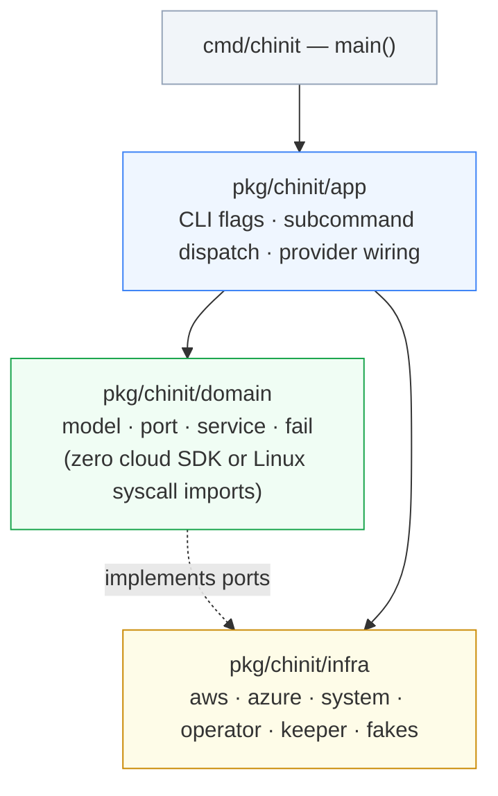
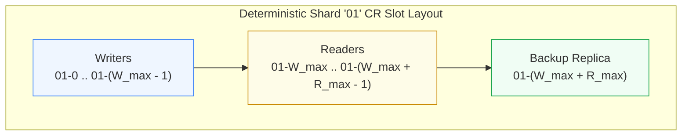

---
# Copyright (C) 2026 StackGen, Inc. All rights reserved.
# SPDX-License-Identifier: Apache-2.0
title: "Architecture"
nav_title: "Architecture"
nav_order: 10
permalink: /architecture/
mermaid: true
description: >-
  chinit internals: hexagonal package boundaries, the boot engine, the
  identity model, retry policies, and the cross-cloud provider
  conformance test suite.
---

# Architecture & Internals

<p class="lead">How <code>chinit</code> is engineered so distributed database bootstrap logic can be tested in milliseconds on a laptop — without AWS accounts, Azure subscriptions, or live Linux VMs.</p>

> Looking for operational usage, configuration, and day-2 runbooks? See the [Operator's Guide]({{ '/guide/' | relative_url }}).

The hardest problem with traditional infrastructure-bootstrap code (shell scripts, Ansible roles, cloud-init templates) is **feedback latency**: the only way to find out if a Spot-interruption race condition or DynamoDB conditional-write edge case works is to spin up real cloud VMs and hope you hit the timing window.

`chinit` is structured as a strict **hexagonal (ports-and-adapters) Go application** specifically so every distributed invariant — lease claiming, bundle invalidation, retry classification, epoch-fenced rollouts, and CR config rendering — runs deterministically in memory under `go test ./...`.



---

## 1. Strict Four-Layer Package Boundaries

Dependencies point strictly inward toward `pkg/chinit/domain/`. No cloud SDK (`aws-sdk-go-v2`, `azuresdk`) or Linux command runner ever leaks above `pkg/chinit/infra/`:

| Layer | Responsibility | Explicitly Out of Scope |
|---|---|---|
| `cmd/chinit` | Thin `main()` entry point invoking `app.Main` | Any flag, domain, or cloud logic |
| `pkg/chinit/app` | Flag parsing, subcommand routing, provider registry assembly, telemetry lifecycle (`boot.go`, `fleettask.go`, `nodestatus.go`) | Direct cloud SDK calls (speaks strictly via `port.Provider`) |
| `pkg/chinit/domain/model` | Pure data models (`BootSpec`, `NodeIdentity`, disruption budgets, hooks) and validation invariants | I/O, network calls, or filesystem access |
| `pkg/chinit/domain/port` | Minimal `Provider` interface plus runtime capability probes (`AsOrdinalClaimer`, `AsDNSRegistrar`, `AsSpotSignals`, `AsStatusPublisher`) | Concrete cloud implementations |
| `pkg/chinit/domain/service` | The 26-step boot pipeline, `ParallelGroup` barrier, retry engine, state ledger, `/etc/hosts` & DNS convergence, and epoch-fenced task coordinator | Cloud SDKs or raw `exec.Command` calls |
| `pkg/chinit/domain/fail` | Explicit `Retryable` vs. `Fatal` error algebra | — |
| `pkg/chinit/infra/*` | Concrete adapters: `aws/`, `azure/`, `detect/`, `operator/` (ClickHouse XML renderer), `keeper/` (`mntr` probe), `system/` (disks, sysctls, `systemd`), and `fakes/` | Pipeline ordering or policy decisions |

Because everything lives under `pkg/chinit/` (not `internal/`), external Go tools can import `chinit`'s domain models or register custom private-cloud providers directly in the provider registry.

---

## 2. The Retry Engine, `ParallelGroup`, and Single-Owner `state.json`

### Deliberate Error Classification (`fail.Fatal` vs. Transient)
Cloud environments fail in two fundamentally different ways:
1. **Eventual-consistency delays** (an EBS volume takes 25 seconds to attach, IAM credentials take 4 seconds to propagate, Route 53 throttles a request) — these **must retry** with bounded backoff and jitter.
2. **Configuration bugs** (`config_bundle.sha256` doesn't match, `storage.xml` is malformed XML, IAM returns `AccessDenied`) — retrying these for 15 minutes only hides broken deployments. Wrapping an error with `fail.Fatal(err)` short-circuits `engine.Do` immediately.

```go
apiRetry      = Policy{Attempts: 5,  BaseDelay: 2s, MaxDelay: 10s}
bootWait      = Policy{Attempts: 30, BaseDelay: 2s, MaxDelay: 10s}
ebsAttachWait = Policy{Attempts: 60, BaseDelay: 3s, MaxDelay: 10s, Deadline: 5m}
onceFatal     = Policy{Attempts: 1}
claimSweep    = Policy{Attempts: 3,  BaseDelay: 5s, MaxDelay: 60s, Deadline: 16m}
```

### Race-Free State Persistence
During Phase 1, seven steps execute concurrently inside a `ParallelGroup` (`errgroup`). Both `settle_identity` (writing the claimed ordinal/lease) and sibling steps (recording `done` statuses) update `/var/lib/chinit/state.json`. To prevent concurrent goroutines from clobbering each other's JSON writes, `engine.Run` owns a single synchronized in-memory `modelState` instance and flushes atomic writes on every state transition:

```go
type modelState struct {
    Identity *bootIdentity `json:"identity,omitempty"`
    SpecHash string        `json:"spec_hash,omitempty"`
    Steps    []stepRecord  `json:"steps"`
}
```

If `SpecHash` changes on a subsequent boot, `engine.Run` preserves `Identity` (so the node never orphans its replica slot!) while clearing `Steps` so every configuration file is re-rendered against the new bundle.

---

## 3. Bridging Elastic VM Leases to Operator CR Slot Names

How does `chinit` reuse the `clickhouse-operator` XML rendering engine when VMs scale dynamically inside Auto Scaling Groups?

After `settle_identity` establishes the node's logical hostname (`writer-0`, `reader-3`, `backup-0`), `chinit` maps it onto a deterministic **CR slot coordinate** (`<shard>-<index>`):



- **Shard `01` is invariant**: Because `{shard}` expands into every `ReplicatedMergeTree` Keeper znode path (`/clickhouse/tables/01/<table>`), keeping shard `01` fixed ensures Keeper metadata never re-keys.
- **Disjoint slot ranges**: Writers occupy `01-0 .. 01-(writer_max - 1)`, readers occupy `01-(writer_max) .. 01-(writer_max + reader_max - 1)`, and the dedicated backup replica sits at `01-(writer_max + reader_max)` so it receives full ZooKeeper and macro configs as a replication peer.
- **In-process XML generation**: `pkg/chinit/infra/operator` feeds `chi.yaml` / `keeper.yaml` plus the live lease inventory into `NodeRenderer.RenderNode(...)`, writing validated, `0640`/`0644` XML files into `config.d/` and `users.d/` and pruning any stale files left from earlier topologies.

---

## 4. Epoch-Fenced Fleet Coordination & Dual-Path Telemetry

### Compare-and-Swap Task Fencing
Without etcd or `kube-apiserver`, `chinit` implements distributed rolling updates (`fleet-converge` + `task-poll`) over DynamoDB conditional expressions and Azure Table Storage `ETag` preconditions:
- Every fleet task carries a monotonically increasing `epoch`.
- If a node crashes mid-task and its heartbeat expires, the coordinator increments `epoch` and re-dispatches the task.
- If the original node wakes up from a network partition and tries to write a stale completion, the conditional write on `epoch` is rejected — guaranteeing at-most-once active execution per epoch.

### Push + Pull Observability
- **OTLP Push (`pkg/chinit/telemetry`)**: Oneshot `systemd` maintenance timers live for only a few seconds — far shorter than a 60-second Prometheus scrape interval. `chinit` records step timings and job outcomes in-process and flushes OTLP metrics (`chinit_boot_step_duration_seconds`, `chinit_job_runs`, `chinit_keeper_up`, `chinit_disk_*`) before `main()` exits.
- **Prometheus Scrape (`chinit exporter`)**: A long-lived daemon on `:9150` exposes cluster-wide lease, task, and cordon gauges on `/metrics` alongside proxied ClickHouse server metrics on `/clickhouse-metrics`.

---

## 5. The Cross-Cloud Provider Conformance Suite

How do we guarantee that AWS (IMDSv2 + S3 + Secrets Manager + DynamoDB + Route 53) and Azure (IMDS + Blob + Key Vault + Table Storage + Private DNS) behave identically under contention?

`pkg/chinit/domain/service/conformance` defines a shared black-box test suite that exercises every provider adapter against `pkg/chinit/infra/fakes`:
- Metadata discovery and region/IP extraction,
- Secret fetching and missing-secret failure semantics,
- Bundle download and tamper-detection (`fail.Fatal` on SHA-256 mismatch),
- Concurrent ordinal claiming, lease expiration takeover, renewal, and release,
- DNS `A`-record idempotency and Spot preemption channel delivery.

Adding a third cloud provider (such as GCP) is as straightforward as implementing `port.Provider` under `pkg/chinit/infra/gcp` and passing the conformance suite.

---

## Six Non-Negotiable Core Invariants

Every pull request to `chinit` is reviewed against six architectural invariants:

1. **Identity precedes rendering**: No config file may be rendered before `settle_identity` persists to `state.json`, and background subcommands always read `state.json` rather than re-deriving identity.
2. **Shard `01` is immutable**: Changing the shard identifier would orphan existing `ReplicatedMergeTree` Keeper paths.
3. **Keeper Raft IDs are 1-based and sticky on disk**: `configure_keeper` reads an existing `myid` from the persistent Raft volume first, seeding `ordinal + 1` only on a blank disk.
4. **`Fatal` vs. `Retryable` is explicit**: Deterministic misconfigurations (hash mismatch, invalid XML, missing binaries, `AccessDenied`) must wrap `fail.Fatal`.
5. **Spec is data; binary is logic**: All control flow lives in tested Go packages, never in templated shell strings inside `chinit.yaml`.
6. **Shutdown drain runs inside `systemd` teardown**: `chinit-shutdown-drain.service` executes `Before` `clickhouse-server` stops (`After=clickhouse-server` in unit ordering), never calls `systemctl stop clickhouse-server` recursively, and exits cleanly when `reboot.target` is active.

---

## Annotated Source Tree

```
cmd/chinit/main.go                 Minimal CLI entry point
pkg/chinit/app/
  app.go                           Subcommand dispatch & exit-code mapping
  boot.go                          Boot orchestration, provider wiring, state store
  fleettask.go                     fleet-converge, task-poll, fleet-rollout, exporter CLIs
  nodestatus.go                    fleet-status, cordon, uncordon, and disruption gates
pkg/chinit/domain/
  model/spec.go                    BootSpec schema & validation rules
  model/budget.go                  Disruption budget definitions
  port/provider.go                 Provider core & optional capability interfaces
  port/fleettask.go                FleetTaskStore, MotionRunner, and DisruptionGate ports
  service/steps.go                 26-step boot pipeline definitions
  service/engine.go                Retry engine, ParallelGroup barrier, single-owner state
  service/fleettask.go             Epoch-fenced coordinator sweep & node executor
  service/rollout.go               Disruption-aware & Keeper-quorum-safe rollout planner
  service/render.go                In-process ClickHouse & Keeper config rendering
  service/units.go                 Per-role systemd service & timer composition
  service/hosts.go                 /etc/hosts peer reconciliation
  service/peerdns.go               Private DNS convergence & expired-slot sweep
  service/peerrservers.go          remote_servers XML convergence & hot reload
  service/conformance/             Cross-cloud provider conformance test suite
  fail/                            Retryable vs. Fatal error classification
pkg/chinit/infra/
  detect/                          Cloud auto-detection (flag → env → DMI → IMDS)
  operator/                        Embedded clickhouse-operator rendering & schema adapters
  keeper/                          ClickHouse Keeper 4-letter mntr quorum probe
  system/                          LABEL disk mounting, THP/sysctl tuning, systemd installer
  aws/, azure/                     Production cloud adapters
  fakes/                           In-memory cloud doubles for fast deterministic tests
pkg/chinit/logger/                 Structured JSON logging
pkg/chinit/telemetry/              OpenTelemetry OTLP metrics & flush lifecycle
```
