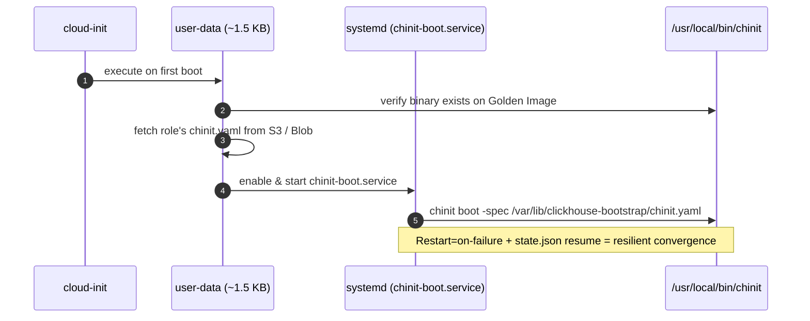
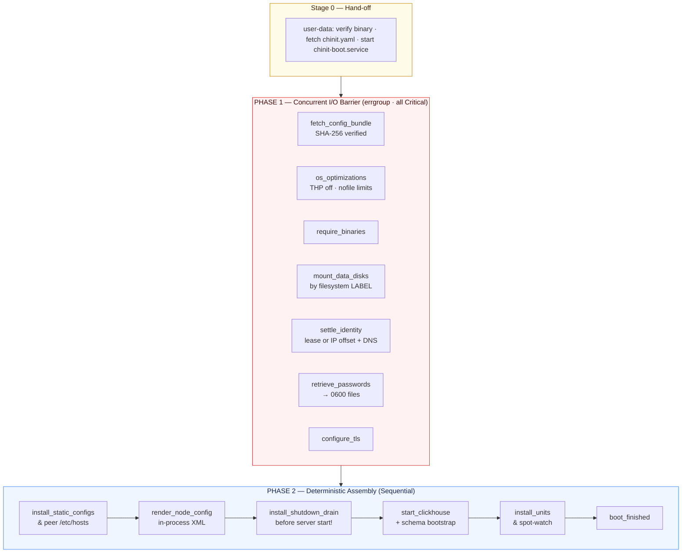
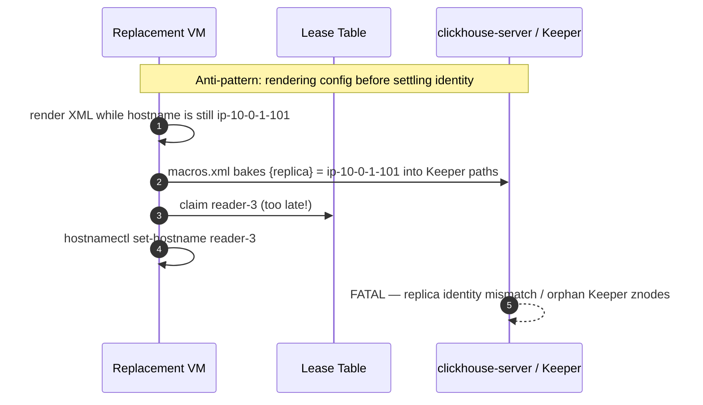
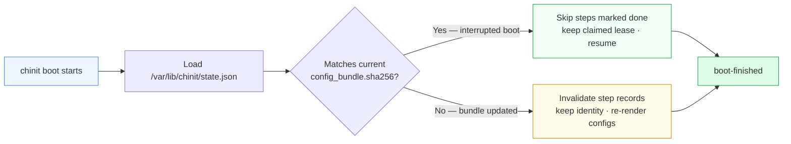
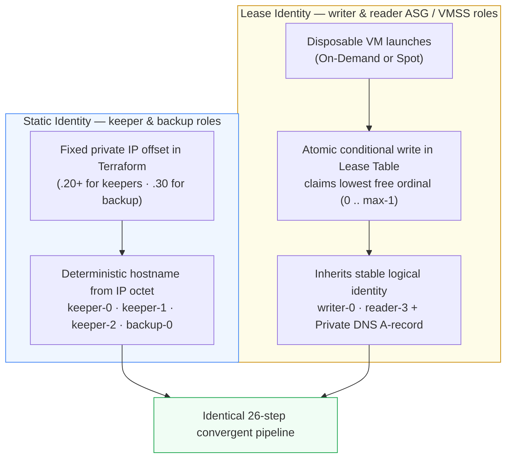

---
# Copyright (C) 2026 StackGen, Inc. All rights reserved.
# SPDX-License-Identifier: Apache-2.0
title: The boot process
nav_title: Boot process
nav_order: 5
permalink: /boot/
mermaid: true
description: >-
  Inside the ~150 seconds between VM power-on and a healthy ClickHouse
  replica — the two-phase, convergent, resumable boot pipeline chinit
  runs on every node.
---

# The Boot Process

Inside the ~150 seconds between VM power-on and a healthy ClickHouse replica — and why step concurrency, ordering barriers, and resumable state matter.

Bootstrapping a distributed database node on a cloud VM is a race against cloud eventual consistency. At the moment `cloud-init` starts, EBS or Azure Managed Disks may still be attaching asynchronously, IAM instance credentials may take a few seconds to propagate, and a predecessor VM that died 30 seconds ago may still have a lingering DNS record.

If a bootstrap script runs top-to-bottom in bash with `set -e`, a single transient cloud API blip kills the entire boot — or worse, leaves the node half-configured. `chinit boot` solves this by modeling instance startup as a **two-phase, convergent, resumable state machine**.

---

## Stage 0: The ~1.5 KB User-Data Hand-off

Cloud `user-data` scripts are notoriously hard to test, version, and observe. In a `chinit` fleet, `user-data` does almost nothing: it verifies `/usr/local/bin/chinit` exists on the golden image, downloads the role's `chinit.yaml` spec from object storage, and hands control to `systemd` (`chinit-boot.service` with `Restart=on-failure`):

There is no "stage 2" bash script hidden inside the config bundle. Every line of logic that touches disks, secrets, DNS, XML rendering, or ClickHouse lives inside the compiled, unit-tested `chinit` binary.

---

## Phase 1 (Parallel) & Phase 2 (Sequential)

Why does `chinit` split its 26 boot steps into two phases?

- **Speed in Phase 1 (`errgroup` concurrency)**: Waiting sequentially for cloud volume attachment (~15–45 s), S3 bundle download, Secrets Manager calls, and DynamoDB lease claiming wastes precious scale-out time. Because these seven I/O-bound tasks write to completely disjoint paths, `chinit` runs them **in parallel** — bounding Phase 1 latency by the single slowest cloud call rather than their sum.
- **Safety in Phase 2 (deterministic sequence)**: Once the Phase 1 barrier completes, the node has a verified bundle, mounted disks, `0600` secret files, and a settled identity. Phase 2 then renders ClickHouse configs, registers shutdown hooks, starts the server, and wires up maintenance timers in a strict deterministic order.

### Three Ordering Rules That Prevent Production Outages

  

    <h4>1. Identity Before Rendering</h4>
    
The node's logical hostname (<code>reader-3</code>, never <code>ip-10-0-1-101</code>) must be claimed and persisted <em>before</em> XML rendering begins. Otherwise ephemeral EC2/VMSS hostnames get baked into ClickHouse Keeper replica paths and <code>macros.xml</code>.

  

  

    <h4>2. Secrets Before Rendering</h4>
    
ClickHouse user profiles reference secrets via <code>passwordFrom</code> files on disk. Resolving Secrets Manager / Key Vault secrets into <code>0600</code> files in Phase 1 ensures ClickHouse never starts with missing or world-readable credentials.

  

  

    <h4>3. Shutdown Drain Before Server Start</h4>
    
<code>install_shutdown_drain</code> runs immediately after config rendering — <em>before</em> <code>start_clickhouse</code>. If an Auto Scaling Group terminates the VM while ClickHouse is still starting up, the node still releases the lease it claimed in Phase 1.

  

Here is what happens in naive bootstrap scripts that violate Rule #1:

---

## Convergent, Resumable Execution (`state.json`)

Every step in `chinit` is **convergent**: before doing work, it inspects actual OS state (is `CH_METADATA` already mounted? does `state.json` already hold a valid lease? do the rendered XML files match?).

As each step succeeds, `chinit` records its completion timestamp and duration in `/var/lib/chinit/state.json`, pinned to `config_bundle.sha256`:

Furthermore, every step is explicitly classified by **Criticality** and **Failure Kind**:
- **🔒 Critical vs. ⚠️ BestEffort**: If `fetch_config_bundle` or `settle_identity` fails, booting further would corrupt the cluster — so `chinit` aborts immediately (`Critical`). Conversely, if a peer node is temporarily rebooting during `health_gate` or if an OTel collector endpoint is unreachable during `configure_monitoring`, `chinit` logs a structured warning and still lets the database node come online (`BestEffort`).
- **`Retryable` vs. `Fatal` errors**: Throttled cloud API calls or volumes still attaching retry with exponential backoff and jitter. Checksum mismatches, malformed XML, or IAM `AccessDenied` errors fail immediately via `fail.Fatal` instead of wasting 15 minutes retrying a permanent configuration bug.

---

## Complete 26-Step Pipeline Reference

| Phase | Step | Criticality | What It Accomplishes |
|---|---|---|---|
| **Pre** | `hooks_pre_boot` | 🔒 Critical | Runs optional `pre_boot` shell hooks with `CHINIT_*` identity variables. |
| **Phase 1** | `fetch_config_bundle` | 🔒 Critical | Downloads `chi.yaml`, `keeper.yaml`, XMLs, and `bootstrap-ddl.sql` from S3/Blob and enforces `config_bundle.sha256`. |
| **Phase 1** | `os_optimizations` | 🔒 Critical | Disables Transparent Huge Pages (`never`), tunes `fs.file-max`, `limits.conf`, and systemd `LimitNOFILE`. |
| **Phase 1** | `require_binaries` | 🔒 Critical | Verifies `clickhouse-server`, `clickhouse-client`, `chinit`, and cloud CLI binaries are present. |
| **Phase 1** | `mount_data_disks` | 🔒 Critical | Waits up to 5 min for async volume attachment; mounts `CH_METADATA` by filesystem `LABEL` (formatting blank disks only). Cache/Keeper labels fall back safely to local directories if omitted. |
| **Phase 1** | `settle_identity` | 🔒 Critical | Claims an atomic ordinal lease (`writer-N`, `reader-N`) or derives a static hostname from the IP octet, sets OS hostname, updates Private DNS, and persists identity to `state.json`. |
| **Phase 1** | `retrieve_passwords` | 🔒 Critical | Resolves secret names from AWS Secrets Manager or Azure Key Vault into `0600` local files. |
| **Phase 1** | `configure_tls` | 🔒 Critical | Installs TLS certificates from secrets or generates a self-signed certificate pair for encrypted interserver replication. |
| **Phase 2** | `install_static_configs` | 🔒 Critical | Validates XML syntax before installing `network.xml`, `ssl.xml`, `storage.xml`, and role-specific overlays into `/etc/clickhouse-server/config.d`. |
| **Phase 2** | `configure_peer_hosts` | 🔒 Critical | Reconciles `/etc/hosts` from active peer leases so inter-replica part fetches resolve without DNS race windows. |
| **Phase 2** | `configure_server_env` | 🔒 Critical | Writes `/etc/default/clickhouse-server` and systemd environment drop-ins (such as `CH_S3_ENDPOINT`). |
| **Phase 2** | `render_node_config` | 🔒 Critical | Runs the embedded `clickhouse-operator` renderer to produce host macros, `remote_servers`, Keeper client endpoints, and `users.d` profiles, pruning stale files. |
| **Phase 2** | `configure_keeper` | 🔒 Critical | On `keeper` nodes: renders single-file Keeper config, reconciles the 1-based `myid` Raft ID on persistent storage, disables `clickhouse-server`, and enables `clickhouse-keeper`. |
| **Phase 2** | `write_node_env` | ⚠️ BestEffort | Writes `/var/lib/clickhouse-bootstrap/node-env` (`ROLE`, `HOSTNAME`, `CLUSTER`) for operator convenience. |
| **Phase 2** | `install_shutdown_drain` | 🔒 Critical | Installs `chinit-shutdown-drain.service` right away so any subsequent shutdown cleanly releases the claimed lease. |
| **Phase 2** | `start_clickhouse` | 🔒 Critical | Enables and starts `clickhouse-server`, polls `/ping` until ready, and verifies S3 tiered-storage disk access (skipped on `keeper` nodes). |
| **Phase 2** | `detect_storage_loss` | ⚠️ BestEffort | Detects when a freshly imaged VM claims an ordinal that still has replica metadata in Keeper alongside an empty local data disk. |
| **Phase 2** | `bootstrap_schema` | ⚠️ BestEffort | Applies `bootstrap-ddl.sql` idempotently (`CREATE ... IF NOT EXISTS`), automatically recovering `REPLICA_ALREADY_EXISTS` after storage loss. |
| **Phase 2** | `health_gate` | ⚠️ BestEffort | Probes cluster health across live peers (non-fatal so nodes can still boot while another peer is undergoing maintenance). |
| **Phase 2** | `prometheus_reload` | ⚠️ BestEffort | Reloads config and verifies ClickHouse's `:9363/metrics` Prometheus endpoint responds. |
| **Phase 2** | `install_units` | 🔒 Critical | Installs and enables role-appropriate `systemd` services and timers (`lease-renew`, `schema-sync`, `replica-sync`, `queue-heal`, `disk-autoscale`, …). |
| **Phase 2** | `configure_backup` | 🔒 Critical | Configures `clickhouse-backup` and enables the daily backup timer when `backup.bucket` is set on the backup replica. |
| **Phase 2** | `configure_monitoring` | ⚠️ BestEffort | Configures OpenTelemetry Collector or Fluent Bit when `log_shipping.endpoint` is specified. |
| **Phase 2** | `configure_cloudwatch` | ⚠️ BestEffort | Configures the CloudWatch agent on AWS nodes. |
| **Phase 2** | `install_spot_watch` | ⚠️ BestEffort | Starts `chinit-spot-watch.service` on writer + reader nodes to poll 2-second Spot preemption notices and trigger early draining (both ASG roles hold a replica registration, an ordinal lease and a DNS record to release). |
| **Phase 2** | `boot_finished` | 🔒 Critical | Writes `/var/lib/cloud/instance/boot-finished` and emits structured per-step timing telemetry. |
| **Post** | `hooks_post_boot` | ⚠️ BestEffort | Runs optional `post_boot` shell hooks (e.g., cache warming or external service registration). |

---

## How Identity Modes Work Across the Four Node Roles

A production ClickHouse cluster isn't homogeneous: **consensus nodes** (`keeper`) want fixed network addresses so Raft peers always find quorum, while **compute/query nodes** (`writer` and especially Spot `reader` pools) want elastic horizontal scaling. `chinit` supports both in the same cluster:

When a Spot `reader-3` instance is reclaimed by AWS or Azure, its shutdown drain releases slot `3`. Seconds later, the Auto Scaling Group launches a fresh VM on a brand-new IP address; that VM claims slot `3`, updates `reader-3.<dns_zone>` to its new IP, re-syncs from peers, and resumes serving queries — with zero manual intervention.

Continue to [Maintenance Jobs]({{ '/maintenance/' | relative_url }}) to see how `chinit` keeps the node healthy after `boot_finished`, or inspect [The Spec]({{ '/spec/' | relative_url }}) to configure your roles.
