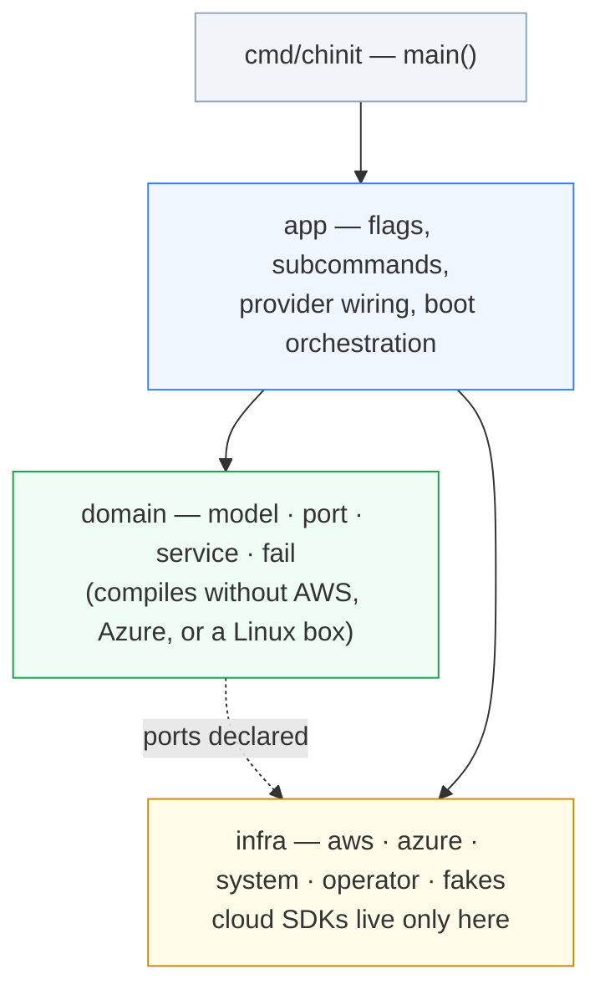

<!--
  Copyright (C) 2026 StackGen, Inc. All rights reserved.
  SPDX-License-Identifier: Apache-2.0
-->

# chinit Architecture

> For operational usage, configuration, and CLI commands, see [chinit.md](./chinit.md).

`chinit` bootstraps and manages a ClickHouse node on cloud VMs: it detects the cloud platform, downloads a SHA-256 verified configuration bundle, converges the node to a declarative spec, and installs recurring maintenance jobs as systemd subcommands.



This document is for contributors and explains how the binary is structured, why each package layer exists, and how the core invariants are enforced.

## High-Level Structure

`chinit` is a single process organized into four layers under `pkg/chinit/`, with no cloud SDK imports above `pkg/chinit/infra/`:

```
cmd/chinit ──► pkg/chinit/app ──► pkg/chinit/domain ──► pkg/chinit/infra
   main()        flags,             model, port,          aws/, azure/,
                 subcommands,       service (engine,      detect/, system/,
                 provider wiring    steps, units), fail   operator/, fakes/
```

Dependencies point inward toward `domain/`. The `domain/` packages compile without AWS, Azure, or Linux-specific dependencies, while `infra/` adapts cloud SDKs and operating system calls to the interfaces declared in `domain/port`. Because these packages live under `pkg/chinit/`, external Go consumers can import them directly to build custom tooling or register additional cloud providers.

## Package Responsibilities

| Layer | Responsibilities | Out of Scope |
|---|---|---|
| `cmd/chinit` | `main()` entry point calling `app.Main` | Application or domain logic |
| `app/` | CLI flag parsing, subcommand dispatch, provider registry wiring, and boot orchestration (`pkg/chinit/app/boot.go`) | Direct cloud SDK calls (interacts through `port.Provider`) |
| `domain/model` | Data structures (`BootSpec`, `NodeIdentity`, role/mode enums, disruption budgets, lifecycle hooks) and validation | I/O or side effects |
| `domain/port` | Capability interfaces and runtime capability probes (`AsOrdinalClaimer`, `AsDNSRegistrar`, `AsSpotSignals`, `AsStatusPublisher`) | Concrete implementations |
| `domain/service` | Boot pipeline (`steps.go`), retry engine (`engine.go`), config rendering (`render.go`), systemd unit generation (`units.go`), fleet task coordination (`fleettask.go`), and state persistence | Direct cloud or OS calls |
| `domain/fail` | `Retryable` vs. `Fatal` error classification | — |
| `infra/detect` | Cloud detection (`-cloud` flag → `CHINIT_CLOUD` env → DMI `sys_vendor` → IMDS probe) | — |
| `infra/aws`, `infra/azure` | Cloud provider adapters (metadata, secrets, bundle fetch, ordinal leases, DNS, spot notices, volume autoscaling, fleet tasks, status rows) | Boot pipeline orchestration |
| `infra/operator` | Wrappers around the `clickhouse-operator` configuration renderer, schema propagation, and health probing | — |
| `infra/system` | Local machine operations: disk mounting, OS tuning, static XML validation/installation, and systemd unit installation | Cloud API calls |
| `infra/fakes` | In-memory test doubles for IMDS, secrets, config bundles, leases, and fleet tasks used by the conformance suite | — |

As a rule of thumb: if logic applies across clouds, it belongs in `domain/`; if it calls a cloud SDK or REST API, it belongs in `infra/<cloud>/`; if it mutates local OS files or services, it belongs in `infra/system/`.

## Provider Interface: Mandatory Core and Optional Capabilities

`port.Provider` keeps the required interface minimal so every cloud adapter implements four core methods:

```go
// pkg/chinit/domain/port/provider.go
type Provider interface {
    Name() string
    MetadataProvider          // instance ID, region, private IP
    port.SecretSource         // secret resolution by name
    ConfigSource              // SHA-256 verified config bundle download
}
```

Additional cloud features are modeled as optional capability interfaces probed at runtime:

```go
func AsOrdinalClaimer(p Provider) OrdinalClaimer     // lease-based node identity
func AsDNSRegistrar(p Provider) DNSRegistrar         // private DNS A-record management
func AsSpotSignals(p Provider) SpotSignals           // spot / preemption notices
func AsStatusPublisher(p Provider) StatusPublisher   // fleet status & cordon rows
```

When a provider does not implement an optional capability, `chinit` logs a clear warning and skips the optional behavior — unless the spec explicitly requires it (for example, `identity_mode: lease` without an `OrdinalClaimer` fails fatally because booting an auto-scaled node with an ephemeral IP hostname would corrupt replication identity).

## The Boot Pipeline

`app.Main("boot", ...)` detects the cloud, builds the provider, parses `chinit.yaml`, constructs `boot.Steps(ctx)`, and runs them through `engine.Run(ctx, steps)`.

**Phase 1 runs in parallel** (`ParallelGroup` backed by `errgroup`): I/O-bound steps such as downloading the bundle, waiting for attached disks, claiming an ordinal lease, fetching secrets, and configuring TLS are independent and write to disjoint paths. Running them concurrently bounds Phase 1 latency by the slowest operation rather than their sum. If any `Critical` child fails, sibling contexts are canceled and the boot aborts.

**Phase 2 runs sequentially**, consuming the outputs prepared in Phase 1:

| Phase | Step | Criticality | Retry Policy | Purpose |
|---|---|---|---|---|
| Pre | `hooks_pre_boot` | Critical | `onceFatal` | Runs optional `pre_boot` lifecycle hooks. |
| Phase 1 | `fetch_config_bundle` | Critical | `apiRetry` | Downloads XML configs, `chi.yaml`, `keeper.yaml`, and `bootstrap-ddl.sql` from S3/Blob storage and verifies the SHA-256 digest. |
| Phase 1 | `os_optimizations` | Critical | `onceFatal` | Disables THP and configures file descriptor limits and sysctls. |
| Phase 1 | `require_binaries` | Critical | `onceFatal` | Verifies `clickhouse-server`, `clickhouse-client`, and required cloud CLIs are present. |
| Phase 1 | `mount_data_disks` | Critical | `ebsAttachWait` | Mounts disks by filesystem `LABEL` (waiting up to 5 minutes for async cloud volume attachment) and prepares directories. |
| Phase 1 | `settle_identity` | Critical | `claimSweep` | Claims a lease ordinal or derives a static hostname from the IP offset, updates DNS, and persists identity to `state.json`. |
| Phase 1 | `retrieve_passwords` | Critical | `apiRetry` | Resolves secret names from the cloud secret store into `0600` files. |
| Phase 1 | `configure_tls` | Critical | `apiRetry` | Installs TLS certificates from secrets or generates a self-signed certificate pair for interserver replication. |
| Phase 2 | `install_static_configs` | Critical | `onceFatal` | Validates and installs `network.xml`, `ssl.xml`, `storage.xml`, and the backup replica overlay. |
| Phase 2 | `configure_peer_hosts` | Critical | `onceFatal` | Populates `/etc/hosts` with peer short names for inter-node replication fetches. |
| Phase 2 | `configure_server_env` | Critical | `onceFatal` | Writes `/etc/default/clickhouse-server` and the systemd environment drop-in (`CH_S3_ENDPOINT`). |
| Phase 2 | `render_node_config` | Critical | `onceFatal` | Renders ClickHouse configuration and `users.d` files in-process. |
| Phase 2 | `configure_keeper` | Critical | `onceFatal` | On `keeper` nodes, renders the single-file Keeper config, reconciles the 1-based `myid` Raft ID, and enables `clickhouse-keeper`. |
| Phase 2 | `write_node_env` | BestEffort | `onceFatal` | Writes `/var/lib/clickhouse-bootstrap/node-env` for shell script compatibility. |
| Phase 2 | `install_shutdown_drain` | Critical | `onceFatal` | Installs `chinit-shutdown-drain.service` immediately after identity setup so any termination during or after boot releases the lease. |
| Phase 2 | `start_clickhouse` | Critical | `onceFatal` | Enables and starts `clickhouse-server` and waits for `/ping` (skipped on `keeper` nodes). |
| Phase 2 | `detect_storage_loss` | BestEffort | `onceFatal` | Logs when a re-imaged node claims an ordinal that has existing Keeper replica registrations but an empty local data directory. |
| Phase 2 | `bootstrap_schema` | BestEffort | `apiRetry` | Applies `bootstrap-ddl.sql` idempotently (`CREATE ... IF NOT EXISTS` with `{shard}`/`{replica}` macros). |
| Phase 2 | `health_gate` | BestEffort | `onceFatal` | Probes cluster health across live peers (non-fatal so nodes can still join while a peer is down). |
| Phase 2 | `prometheus_reload` | BestEffort | `bootWait` | Reloads config and verifies the `:9363/metrics` endpoint. |
| Phase 2 | `install_units` | Critical | `onceFatal` | Installs and enables systemd services and timers for recurring maintenance subcommands. |
| Phase 2 | `configure_backup` | Critical | `onceFatal` | Configures `clickhouse-backup` and its daily timer when a backup bucket is specified. |
| Phase 2 | `configure_monitoring` | BestEffort | `onceFatal` | Configures OpenTelemetry Collector or Fluent Bit when `log_shipping.endpoint` is set. |
| Phase 2 | `configure_cloudwatch` | BestEffort | `onceFatal` | Configures the CloudWatch agent on AWS nodes. |
| Phase 2 | `install_spot_watch` | BestEffort | `onceFatal` | Installs the spot interruption watcher on reader nodes. |
| Phase 2 | `boot_finished` | Critical | `onceFatal` | Writes `/var/lib/cloud/instance/boot-finished` and emits step timing metrics. |
| Post | `hooks_post_boot` | BestEffort | `onceFatal` | Runs optional `post_boot` lifecycle hooks. |

### Retry Engine and Error Classification

Every step executes through `engine.Do(ctx, policy, op)` (`domain/service/engine.go`), which provides bounded retries, exponential backoff with jitter, and per-policy deadlines. Errors wrapped with `fail.Fatal` abort immediately without retrying (for example, IAM `AccessDenied`, bundle SHA-256 mismatch, or malformed XML), while transient errors retry according to the step's policy:

```go
apiRetry      = Policy{Attempts: 5,  BaseDelay: 2s, MaxDelay: 10s}
bootWait      = Policy{Attempts: 30, BaseDelay: 2s, MaxDelay: 10s}
ebsAttachWait = Policy{Attempts: 60, BaseDelay: 3s, MaxDelay: 10s, Deadline: 5m}
onceFatal     = Policy{Attempts: 1}
claimSweep    = Policy{Attempts: 3,  BaseDelay: 5s, MaxDelay: 60s, Deadline: 16m}
```

### State Persistence and Resume

`engine.Run` loads `/var/lib/chinit/state.json` once at startup and updates it as steps complete:

```go
type modelState struct {
    Identity *bootIdentity `json:"identity,omitempty"`
    SpecHash string        `json:"spec_hash,omitempty"`
    Steps    []stepRecord  `json:"steps"`
}
```

- **Resumable execution**: Steps recorded as `done` are skipped on re-run so interrupted boots resume cleanly.
- **Bundle hash invalidation**: If `SpecHash` differs from the current `config_bundle.sha256`, prior step records are cleared and configuration is re-rendered.
- **Single state owner**: Both `settle_identity` and step completion records write through the same in-memory state object to prevent concurrent file overwrites.

## Node Identity and CR Naming

`settle_identity` establishes the node's identity in one of two modes:

- **Static mode** (`keeper`, `backup`): Maps the private IP's last octet to a deterministic hostname (`10.0.1.1x` → `writer-x`, `10.0.1.2x` → `keeper-x`, `10.0.1.30` → `backup-0`).
- **Lease mode** (`writer`, `reader` in Auto Scaling Groups): Claims a free or expired ordinal (`0 .. max-1`) in the cloud lease table using a conditional write, renewed every 5 minutes by `lease-renew` and released on shutdown by `drain-shutdown`.

From the settled hostname, `chinit` derives the **CR slot name** (`01-0 .. 01-(N-1)`) used by the `clickhouse-operator` configuration renderer:
- The shard is always named `01` so `{shard}` macros in Keeper paths remain stable.
- Writers occupy slots `01-0 .. 01-(writer_max - 1)`.
- Readers occupy slots `01-(writer_max) .. 01-(writer_max + reader_max - 1)`.
- The backup replica occupies `01-(writer_max + reader_max)` so it receives rendered macros and ZooKeeper configuration as a full replication peer.
- Keepers have an empty CR slot name because they run `clickhouse-keeper` rather than `clickhouse-server`.

## In-Process Configuration Rendering

`render_node_config` and `configure_keeper` call the `clickhouse-operator` rendering packages directly in-process via `pkg/chinit/infra/operator`:

```
BootSpec ──► LoadCHI/LoadCHK ──► NodeRenderer.RenderNode(...)
                                    │  Hosts:       CR-name → DNS address map
                                    │  Replicas:    CR-name → short hostname map ({replica} macro)
                                    │  Networks:    per-user allowlists + node subnet CIDRs
                                    │  RemoteUser:  distributed-query credentials
                                    │  Keeper:      single-file mode, 1-based Raft IDs, ServerID
                                    ▼
                       config.d/ and users.d/ XML files — validated, chowned,
                       permissioned (0640/0644), and pruned of stale files
```

## Fleet Task Coordination and Observability

### Cross-Node Fleet Tasks

Because a VM fleet has no external Kubernetes controller, `chinit` coordinates rolling refreshes and AMI rollouts through epoch-fenced task rows in the shared claims table:

- **Coordinator (`fleet-converge`)**: Runs on `writer-0` (or the lowest-ordinal live writer via vacancy election). It sweeps task rows every 5 minutes, re-dispatching stale tasks whose executor heartbeat expired (incrementing `epoch`) or marking tasks as failed once retries are exhausted.
- **Executor (`task-poll`)**: Runs every 2 minutes on server nodes, claiming tasks for its hostname behind the cluster disruption budget, running the operation while heartbeating concurrently, and writing an epoch-fenced result.

### Telemetry and Metrics

`chinit` supports two complementary observability paths:

1. **OTLP Push Metrics & Logs (`pkg/chinit/telemetry`)**: Because maintenance subcommands run as short-lived oneshot systemd services, `chinit` pushes OpenTelemetry metrics (`chinit_job_runs`, `chinit_job_duration_seconds`, `chinit_boot_step_duration_seconds`, `chinit_boot_outcomes`, `chinit_keeper_up`, `chinit_disk_*`) to `log_shipping.endpoint` and flushes them before process exit.
2. **Prometheus Scrape Endpoint (`chinit exporter`)**: Runs as a daemon on `:9150`, exposing fleet-wide task/health/cordon metrics on `/metrics` and proxying ClickHouse server metrics on `/clickhouse-metrics`.

## Provider Conformance Suite

`pkg/chinit/domain/service/conformance` defines a shared test suite covering metadata resolution, secret fetching, SHA-256 gated bundle downloads, ordinal lease lifecycle, DNS record updates, and spot interruption signals. Every registered cloud provider runs against this suite using `pkg/chinit/infra/fakes` to guarantee consistent behavior across clouds.

## Core Invariants

1. **Identity precedes rendering**: Any step that renders or installs node configuration must run after `settle_identity`, and background jobs must read `state.json` rather than re-deriving identity.
2. **Shard name `01` is fixed**: The `01` shard name expands into every `ReplicatedMergeTree` Keeper path; changing it would re-key cluster metadata.
3. **Keeper IDs are 1-based and persisted on disk**: `server_id` is read from the persistent raft volume's `myid` file when present and initialized to `ordinal + 1` on a fresh disk.
4. **Fatal vs. Retryable classification is deliberate**: Configuration mismatches (wrong SHA-256, invalid XML, missing binaries, access denied) must fail with `fail.Fatal` rather than retrying blindly.
5. **Spec is data; binary is logic**: Behavioral changes belong in Go code tested by the suite, while `chinit.yaml` stays declarative.
6. **Shutdown drain runs inside systemd teardown**: `chinit-shutdown-drain.service` runs via `ExecStop` ordered `After=clickhouse-server`, never issues conflicting stop commands against systemd, and skips execution when `reboot.target` is active.

## Source Tree Overview

```
cmd/chinit/main.go                 CLI entry point
pkg/chinit/app/
  app.go                           Subcommand dispatch and version info
  boot.go                          Boot orchestration, provider wiring, state store
  fleettask.go                     fleet-converge, task-poll, fleet-rollout, exporter CLIs
  nodestatus.go                    fleet-status, cordon, uncordon CLIs, and disruption gate
pkg/chinit/domain/
  model/spec.go                    BootSpec and validation rules
  model/budget.go                  Disruption budget models
  port/provider.go                 Provider, capability interfaces, and registry
  port/fleettask.go                FleetTaskStore, MotionRunner, and DisruptionGate ports
  port/nodestatus.go               StatusPublisher port
  port/health.go                   ClusterHealthProbe port
  service/steps.go                 Boot pipeline step definitions, identity, TLS, env
  service/engine.go                Retry engine, ParallelGroup, and state store
  service/fleettask.go             Coordinator task sweep and node task executor
  service/budget.go                Disruption budget evaluation
  service/rollout.go               Rolling update evaluation
  service/fleetmetrics.go          Prometheus exposition renderer
  service/render.go                In-process ClickHouse and Keeper config rendering
  service/units.go                 systemd unit composition per role
  service/hosts.go                 /etc/hosts peer convergence
  service/peerdns.go               Private DNS zone convergence and expired-slot cleanup
  service/peerrservers.go          remote_servers convergence and hot reload
  service/conformance/             Provider conformance test suite
  fail/                            Retryable vs. Fatal error classification
pkg/chinit/infra/
  detect/                          Cloud provider detection (flag, env, DMI, IMDS)
  operator/                        clickhouse-operator library adapters
  system/                          Disks, OS tuning, static XML validation, systemd units
  aws/, azure/                     Cloud provider implementations
  fakes/                           In-memory test doubles for conformance tests
pkg/chinit/logger/                 Structured JSON logger
pkg/chinit/telemetry/              OpenTelemetry metrics exporter
```
