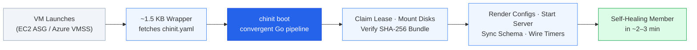
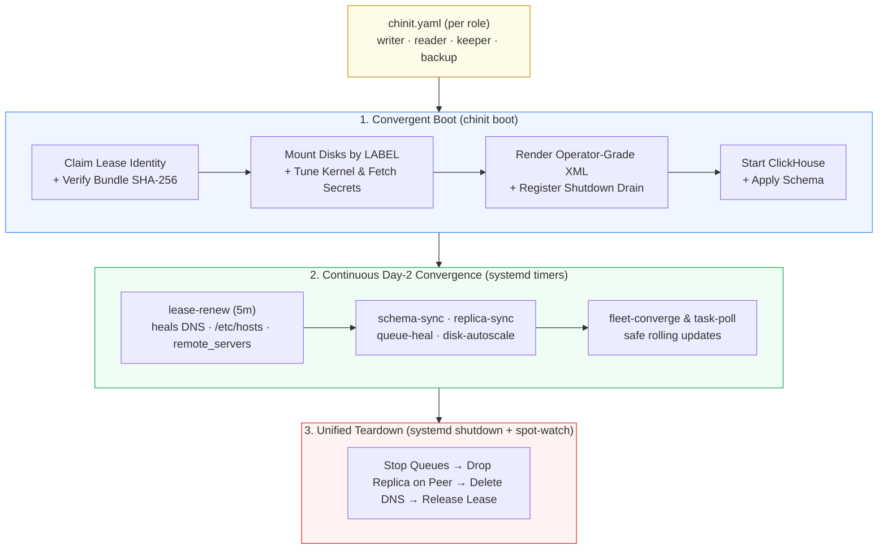

---
# Copyright (C) 2026 StackGen, Inc. All rights reserved.
# SPDX-License-Identifier: Apache-2.0
nav_title: Home
nav_order: 1
permalink: /
mermaid: true
description: >-
  chinit turns a fresh cloud VM into a self-healing ClickHouse cluster
  member in ~2–3 minutes — one static binary, one YAML spec, on AWS
  and Azure, with no Kubernetes and no control plane.
---

# chinit

<p class="pronunciation">Pronounced <strong>“c-h-init”</strong> — short for <strong>ClickHouse&nbsp;init</strong>. Think <code>cloud-init</code>, but for the entire ClickHouse node lifecycle.</p>

<p class="lead"><strong>Operator-grade lifecycle management for ClickHouse on cloud VMs — without Kubernetes, external control planes, or fragile bash scripts.</strong></p>

<div class="badges-row">
  <a href="https://github.com/stackgenhq/chinit/actions/workflows/ci.yml"></a>
  <a href="https://github.com/stackgenhq/chinit/releases"></a>
  <a href="https://github.com/stackgenhq/chinit/blob/main/LICENSE"></a>
  <a href="https://github.com/stackgenhq/chinit/stargazers"></a>
</div>

<div class="cta-row">
  <a class="button button-primary" href="{{ '/quickstart/' | relative_url }}">Get started in 5 minutes →</a>
  <a class="button button-secondary" href="{{ '/terraform/' | relative_url }}">Deploy a cluster with Terraform</a>
  <a class="button button-github" href="https://github.com/stackgenhq/chinit">★ Star on GitHub</a>
</div>

Running ClickHouse directly on cloud virtual machines (AWS EC2 Auto Scaling Groups or Azure Virtual Machine Scale Sets) gives you raw NVMe and EBS throughput, Spot-instance economics, full kernel control, and zero container orchestration overhead.

There is just one catch: **ClickHouse is deeply stateful, while cloud Auto Scaling Groups treat VMs as disposable cattle.**

`chinit` bridges that gap. It is a single static Go binary that turns a newly launched cloud VM into a deterministic, self-healing ClickHouse cluster member in **~2–3 minutes** — and keeps the cluster consistent through Spot interruptions, scale-out bursts, rolling upgrades, and abrupt instance terminations.



## What Problem Is `chinit` Trying to Solve?

Almost every team running ClickHouse on VMs starts the same way: a `cloud-init` shell script in Terraform `user_data` that formats a disk, templates a few XML files with `sed`, and starts `clickhouse-server`.

That script works great on day one — when four fresh VMs boot together on an empty VPC. It falls apart at 2:00 AM six weeks later when the cloud starts churning instances underneath a live cluster:

<div class="grid-3">
  <div class="card">
    <h3>1. The Identity Trap</h3>
    <p>ClickHouse Keeper tracks replicas by stable logical names (<code>reader-2</code>), but Auto Scaling Groups hand every replacement VM a random hostname (<code>ip-10-0-1-147</code>). Render config before claiming a stable identity and the node either refuses to replicate or pollutes Keeper with orphan replica paths.</p>
  </div>
  <div class="card">
    <h3>2. The Silent Termination Trap</h3>
    <p>Spot preemptions and EC2/VMSS health-check kills frequently bypass external lifecycle hooks. Dead nodes leave behind held ordinal slots, stale DNS <code>A</code> records, and ghost entries in <code>remote_servers</code> that stall distributed queries across the fleet.</p>
  </div>
  <div class="card">
    <h3>3. The Day-2 Drift Trap</h3>
    <p>Bootstrapping is only 10% of a database node's life. Over months, disks fill up, replication queues get wedged on missing parts, peers miss DDL while rebooting, and rolling out a new AMI risks taking down the last healthy writer or breaking Keeper Raft quorum.</p>
  </div>
</div>

`chinit` replaces that entire tangle of shell scripts, cron jobs, and ad-hoc Lambda hooks with **one compiled, conformance-tested binary** and **one declarative YAML spec per role**:



## How `chinit` Accomplishes This

### Stable Stateful Identity Inside Disposable Auto Scaling Groups
Writers and readers in Auto Scaling Groups claim a numbered **ordinal lease** (`writer-0`, `reader-3`, …) from DynamoDB or Azure Table Storage using atomic conditional writes *before* a single ClickHouse XML file is rendered. When a Spot reader is reclaimed, its replacement claims the freed `reader-3` slot, updates Private DNS, and picks up replication seamlessly. Keepers and the dedicated backup node use deterministic IP-offset identities so Raft quorum endpoints never move.

### In-Process Operator Config Rendering — Without Running Kubernetes
Under the hood, `chinit` embeds the battle-tested configuration rendering engine from the [Altinity Kubernetes Operator for ClickHouse](https://github.com/Altinity/clickhouse-operator) directly in-process. You write clean `chi.yaml` and `keeper.yaml` topology definitions, and `chinit` generates validated, permissioned `config.d/` and `users.d/` XML files locally on each VM — no Kubernetes API server required.

### Self-Healing Convergence Every 5 Minutes
Distributed systems fail when they rely solely on one-shot edge triggers ("run this script when an instance launches or terminates"). Every 5 minutes, `chinit lease-renew` treats the live lease table as the single source of truth and reconciles `/etc/hosts`, Private DNS `A` records, and ClickHouse `remote_servers` XML. Even if a VM loses power instantaneously (`kill -9` at the hypervisor), its lease expires and every surviving peer heals its routing tables automatically.

### Zero-Control-Plane Fleet Coordination
Need to roll out a new ClickHouse version or configuration change across 20 VMs without dropping queries? `chinit` coordinates rolling updates directly through epoch-fenced compare-and-swap rows in the shared lease table — enforcing **cluster disruption budgets** (`min_healthy_writers`, `min_healthy_readers`) and **ClickHouse Keeper Raft quorum checks** (`mntr`) before touching a single node.

## Why Not Shell Scripts or Kubernetes?

| Capability | Cloud-init Bash Scripts | `chinit` on Cloud VMs | Kubernetes + Operator |
|---|---|---|---|
| **Consistent logic across roles & clouds** | Per-role scripts drift quickly | Single static binary; role is YAML data | Yes |
| **Identity under Spot / ASG churn** | Prone to hostname & Keeper races | Atomic lease claims + self-healing DNS | StatefulSet pod identity |
| **Spot & health-check termination cleanup** | Lifecycle hooks miss abrupt kills | Unified `systemd` shutdown drain + 5m GC | Pod eviction hooks |
| **Direct NVMe, EBS, & kernel control** | Full hardware control | Full hardware control (THP, sysctl, labels) | Constrained by node/CRI |
| **Extra control plane to run & pay for** | None | **None** (uses S3/Blob + DynamoDB/Table) | Kubernetes cluster + CNI + CSI |
| **Offline automated testing** | Almost impossible without live VMs | Unit + cross-cloud conformance test suites | Kind / E2E clusters |

<div class="callout callout-ok">
  <div class="callout-title">Rule of Thumb</div>
  If your organization already runs stateful workloads on Kubernetes, use an operator. If you run ClickHouse on EC2 or Azure VMs for I/O performance, cost efficiency, or simplicity, <code>chinit</code> gives you Kubernetes-operator-grade lifecycle safety with zero control-plane tax.
</div>

## What's Inside the Repository

| Path | What It Provides |
|---|---|
| `cmd/chinit` + `pkg/chinit` | The `chinit` Go binary, convergent boot engine, maintenance subcommands, AWS, Azure & Compose adapters, and conformance test suite |
| `deploy/compose` | Multi-node local Docker Compose cluster (`keeper-0`, `writer-0`, `reader-0`, `otel-collector`) running real `systemd` units using `ghcr.io/stackgenhq/chinit-node` |
| `images/aws` & `images/azure` | Packer definitions that pre-bake Ubuntu 24.04, ClickHouse, `chinit`, `clickhouse-backup`, and monitoring agents into Golden AMIs and Azure Gallery Images |
| `terraform/aws` & `terraform/azure` | Turnkey Terraform modules that provision the lease table, Private DNS zone, KMS/Key Vault secrets, SHA-256 verified config bundle, and node fleets |
| `.github/workflows` | Automated CI, GoReleaser multi-arch static binary releases, GHCR Compose image publishing, and golden image build pipelines |

## Get Started in Minutes — Three Fast Paths

**Path A — Run a 3-node cluster locally with Docker Compose (Copy & Paste).** Save the standalone [`compose.yaml` in the Quickstart]({{ '/quickstart/#try-it-locally-with-docker-compose-copy--paste' | relative_url }}) and boot a full `systemd`-managed `keeper-0` + `writer-0` + `reader-0` cluster on your laptop using our prebuilt `ghcr.io/stackgenhq/chinit-node:latest` image:

```bash
docker compose up -d --wait
docker compose exec writer-0 chinit fleet-status
```

**Path B — Launch a cloud VM immediately.** A prebuilt, **public** golden AMI is published in `us-west-2`, so you can evaluate `chinit` on AWS without waiting for a Packer build:

```bash
aws ec2 run-instances --region us-west-2 \
  --image-id ami-0eaa398497899f070 \
  --instance-type c8g.large \
  --user-data file://wrapper.sh
```

The image ships with Ubuntu 24.04 (`arm64`), ClickHouse `26.8.36.3`, `chinit`, `clickhouse-backup`, and observability agents pre-installed. See [Installation]({{ '/installation/' | relative_url }}) for multi-region copy instructions or building custom images in your own account.

**Path C — Deploy a full cloud cluster.** The [Terraform modules]({{ '/terraform/' | relative_url }}) provision everything — lease table, Private DNS zone, secrets, SHA-256-verified config bundle, IAM/RBAC, and all four node roles — in one `apply`:

```hcl
module "clickhouse" {
  source = "github.com/stackgenhq/chinit//terraform/aws"

  cluster_name  = "demo"
  golden_ami_id = "ami-…"   # or a copied public AMI
  dns_zone_name = "clickhouse.internal"
  subnet_cidr   = "10.42.0.0/24"
}
```

<div class="callout callout-ok">
  <div class="callout-title">Like what you see?</div>
  A <a href="https://github.com/stackgenhq/chinit">star on GitHub</a> helps other ClickHouse operators find the project — and <a href="https://github.com/stackgenhq/chinit/issues">issues</a> and <a href="https://github.com/stackgenhq/chinit/blob/main/CONTRIBUTING.md">contributions</a> are always welcome.
</div>

## Explore the Documentation

<div class="grid-2">
  <div class="card">
    <h3><a href="{{ '/quickstart/' | relative_url }}">Quickstart →</a></h3>
    <p>Walk from a blank VM to a bootstrapped, self-maintaining ClickHouse node in five concrete steps.</p>
  </div>
  <div class="card">
    <h3><a href="{{ '/installation/' | relative_url }}">Installation &amp; Golden Images →</a></h3>
    <p>Verify release binaries, bake 2-minute boot images with Packer, and wire IAM/RBAC permissions.</p>
  </div>
  <div class="card">
    <h3><a href="{{ '/terraform/' | relative_url }}">Deploy with Terraform →</a></h3>
    <p>Provision a complete cluster — compute, identity, DNS, secrets — with the turnkey AWS or Azure modules.</p>
  </div>
  <div class="card">
    <h3><a href="{{ '/boot/' | relative_url }}">The Boot Process →</a></h3>
    <p>Follow the 26-step convergent pipeline, parallel Phase 1 execution, and step-ordering invariants.</p>
  </div>
  <div class="card">
    <h3><a href="{{ '/maintenance/' | relative_url }}">Day-2 Maintenance &amp; Draining →</a></h3>
    <p>See how <code>chinit</code> heals replication queues, autoscales disks, drains Spot nodes, and rolls fleets.</p>
  </div>
  <div class="card">
    <h3><a href="{{ '/spec/' | relative_url }}">The Spec (<code>chinit.yaml</code>) →</a></h3>
    <p>Complete reference for roles, lease ceilings, secrets, disruption budgets, telemetry, and hooks.</p>
  </div>
  <div class="card">
    <h3><a href="{{ '/cli/' | relative_url }}">CLI Reference →</a></h3>
    <p>Every subcommand, flag, schedule, and structured exit code in the <code>chinit</code> binary.</p>
  </div>
  <div class="card">
    <h3><a href="{{ '/guide/' | relative_url }}">Operator's Guide →</a></h3>
    <p>Day-2 operational runbook: in-place config refreshes, cordoning, storage-loss recovery, and debugging.</p>
  </div>
  <div class="card">
    <h3><a href="{{ '/architecture/' | relative_url }}">Architecture &amp; Internals →</a></h3>
    <p>Hexagonal package boundaries, retry policies, CR slot mapping, and the provider conformance suite.</p>
  </div>
</div>

## License

Licensed under the Apache License, Version 2.0. Configuration rendering adapters incorporate code derived from the [Altinity Kubernetes Operator for ClickHouse](https://github.com/Altinity/clickhouse-operator) (Apache-2.0) — see [NOTICE](https://github.com/stackgenhq/chinit/blob/main/NOTICE).
