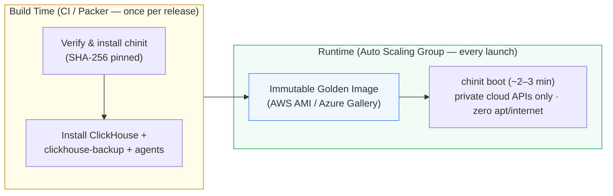

---
# Copyright (C) 2026 StackGen, Inc. All rights reserved.
# SPDX-License-Identifier: Apache-2.0
title: "Installation"
nav_title: "Installation"
nav_order: 3
permalink: /installation/
mermaid: true
description: >-
  Install the chinit static binary or bake golden images: release
  checksum verification, Packer builds for AWS and Azure, the public
  evaluation AMI, and least-privilege IAM/RBAC.
---

# Installation & Golden Images

<p class="lead">Why <code>chinit</code> separates immutable image baking from fast, zero-egress runtime configuration — and how to set up both.</p>

## The Two-Phase Philosophy: Bake Heavy, Boot Fast

When a Spot reader is interrupted during peak traffic, your replacement VM cannot afford to spend 10 minutes running `apt-get update`, pulling multi-hundred-megabyte ClickHouse packages over a NAT gateway, and hoping upstream package mirrors are healthy. If an apt mirror hiccups during an auto-scaling event, your cluster loses capacity right when it needs it most.

`chinit` splits node provisioning into two cleanly separated phases:

1. **Build Time (Golden Image via Packer)**: Heavy, static software — Ubuntu 24.04, `clickhouse-server`, `clickhouse-keeper`, `clickhouse-backup`, cloud CLIs, observability agents, and a version-pinned `/usr/local/bin/chinit` — is baked once into an immutable AMI or Azure Compute Gallery Image.
2. **Boot Time (`chinit boot` in Private Subnets)**: When a VM launches, every binary is already on the root disk. `chinit` only talks to VPC-internal cloud endpoints (S3/Blob, DynamoDB/Table, Secrets Manager/Key Vault, Route 53/Private DNS) and brings the node online in **~2–3 minutes with zero internet egress required**.



---

## Option 1: Install the Static Binary Directly

For custom images, local labs, or existing Linux hosts, download the stripped static binary (`CGO_ENABLED=0`, zero libc/runtime dependencies) from GitHub Releases and verify it against `chinit-SHA256SUMS`:

```bash
CHINIT_VERSION=v0.1.0
ARCH=linux-arm64   # linux-arm64 | linux-amd64 | darwin-arm64 | darwin-amd64

curl -fsSL -o chinit \
  "https://github.com/stackgenhq/chinit/releases/download/${CHINIT_VERSION}/chinit-${ARCH}"
curl -fsSL "https://github.com/stackgenhq/chinit/releases/download/${CHINIT_VERSION}/chinit-SHA256SUMS" \
  | grep "${ARCH}" | sed "s|chinit-${ARCH}|chinit|" | sha256sum -c -

sudo install -m 0755 chinit /usr/local/bin/chinit
/usr/local/bin/chinit version
```

---

## Option 2: Use or Build a Golden Image (Recommended for Production)

The [`images/`](https://github.com/stackgenhq/chinit/tree/main/images) directory ships production-ready Packer templates for AWS and Azure:

| Cloud | Image Artifact | Pre-Baked Stack |
|---|---|---|
| **Local Docker Compose** (`deploy/compose`) | `ghcr.io/stackgenhq/chinit-node:latest` (`linux/amd64`, `linux/arm64`) | ClickHouse `26.8.36.3`, `systemd`, OpenTelemetry Collector, `chinit`, and default local bundle/secrets/specs |
| **AWS** (`images/aws`) | Golden AMI (`arm64`) | Ubuntu 24.04 LTS, ClickHouse, `clickhouse-backup`, AWS CLI v2, CloudWatch & OTel Collector agents, `chinit` |
| **Azure** (`images/azure`) | Azure Compute Gallery Image | Ubuntu 24.04 LTS, ClickHouse, `clickhouse-backup`, Azure CLI, OTel Collector agent, `chinit` |

### Start Immediately with the Public AWS Golden AMI

To evaluate `chinit` without running Packer first, launch our prebuilt public AMI in `us-west-2`:

| Attribute | Value |
|---|---|
| **AMI ID** | `ami-0eaa398497899f070` |
| **Region** | `us-west-2` |
| **Architecture & OS** | Ubuntu 24.04 LTS (`arm64` — AWS Graviton `c8g` / `m8g` / `r8g`) |
| **Pre-Installed Stack** | ClickHouse `26.8.36.3`, `chinit`, `clickhouse-backup` `2.5.0`, AWS CLI v2, CloudWatch agent |

```bash
aws ec2 run-instances \
  --region us-west-2 \
  --image-id ami-0eaa398497899f070 \
  --instance-type c8g.large \
  --user-data file://wrapper.sh
```

Running in another AWS region? Copy the AMI into your own account (which also encrypts the snapshot with your account's KMS key):

```bash
aws ec2 copy-image \
  --source-region us-west-2 \
  --source-image-id ami-0eaa398497899f070 \
  --region <your-region> \
  --encrypted \
  --name clickhouse-golden-26.8.36.3
```

<div class="callout callout-warn">
  <div class="callout-title">Note on Root Snapshot Encryption</div>
  AWS prohibits sharing AMIs publicly if their backing snapshot is encrypted. For that reason, the public evaluation AMI in <code>us-west-2</code> uses an unencrypted snapshot. Always pass <code>--encrypted</code> when copying it to your account or build directly from <code>images/aws</code> (where EBS encryption is enabled by default).
</div>

### Build a Custom Image with Packer

Building from source lets you pin specific ClickHouse releases, bake internal CA certificates, or target custom regions and galleries:

```bash
cd images/aws     # or images/azure
packer init .
packer build -var-file=defaults.pkrvars.hcl clickhouse.pkr.hcl
```

---

## Option 3: Wire `chinit` into Instance Boot & Cloud IAM

The [Terraform modules](https://github.com/stackgenhq/chinit/tree/main/terraform) wire everything together automatically. If you are integrating `chinit` into your own Terraform or CloudFormation/Bicep templates, the contract between your infrastructure and the VM has just three parts:

### 1. A Minimal (~1.5 KB) User-Data Wrapper
Cloud `user_data` (AWS) and `custom_data` (Azure) have strict size limits and are painful to debug when stuffed with hundreds of lines of bash. With `chinit`, user-data only does three things:
1. Confirms `/usr/local/bin/chinit` exists on the disk.
2. Downloads the role's `chinit.yaml` from S3 or Azure Blob Storage into `/var/lib/clickhouse-bootstrap/chinit.yaml`.
3. Writes and starts `chinit-boot.service` (`Restart=on-failure`) running `chinit boot -spec /var/lib/clickhouse-bootstrap/chinit.yaml`.

### 2. Zero Static Credentials — Least-Privilege Instance Identity
`chinit` never stores cloud API keys on disk. It authenticates exclusively through the VM's **IAM Instance Profile** (AWS) or **Managed Identity** (Azure), requiring four scoped capabilities:

| Capability | AWS Service | Azure Service | Why `chinit` Needs It |
|---|---|---|---|
| **Config Bundle Read** | S3 (`GetObject`, `ListBucket`) | Blob Storage (`Storage Blob Data Reader`) | Download `chinit.yaml` and the SHA-256 verified config bundle |
| **Secret Resolution** | Secrets Manager (`GetSecretValue`) | Key Vault (`Key Vault Secrets User`) | Fetch database passwords & TLS certs into `0600` local files |
| **Lease & Fleet Ledger** | DynamoDB (`GetItem`, `PutItem`, `UpdateItem`, `Query`, `Scan`) | Table Storage (`Storage Table Data Contributor`) | Claim/renew ordinal leases, publish health status, coordinate rollouts |
| **Private DNS Updates** | Route 53 (`ChangeResourceRecordSets`, `ListResourceRecordSets`) | Private DNS (`Private DNS Zone Contributor`) | Register node `A` records at boot and sweep stale records on churn |

*(Optional: EC2 `ModifyVolume` / Azure Disk write permissions if you enable online `disk-autoscale`, and S3/Blob read-write on the data/backup buckets for tiered storage and `clickhouse-backup`.)*

### 3. Cloud-Neutral Environment Variables on Azure
To keep `chinit.yaml` portable across clouds, Azure resource coordinates are injected via `systemd` environment variables by the user-data wrapper:

| Environment Variable | Purpose |
|---|---|
| `CHINIT_AZURE_SUBSCRIPTION_ID` | Azure subscription ID for Private DNS updates and online Managed Disk resizing |
| `CHINIT_AZURE_RESOURCE_GROUP` | Resource group hosting the cluster's Private DNS zone and VM resources |
| `CHINIT_AZURE_STORAGE_ACCOUNT` | Storage account hosting the configuration bundle container and lease table |
| `CHINIT_AZURE_VAULT_NAME` | Azure Key Vault name used to resolve secret names listed in `chinit.yaml` |
| `CHINIT_AZURE_VM_NAME` | Current VM or VMSS instance name (used when growing attached data disks online) |

---

## Verifying an Installed Node

Once an instance launches, four commands tell you everything about its health:

```bash
chinit version                                    # Confirm installed binary build
sudo cat /var/lib/chinit/state.json               # Inspect claimed identity & per-step timings
systemctl list-timers 'chinit-*'                  # Confirm day-2 maintenance timers are armed
journalctl -u chinit-boot.service -n 50           # Read structured JSON boot logs
```

A node is ready for traffic when `/var/lib/chinit/state.json` marks `boot_finished` as `done` and `/var/lib/cloud/instance/boot-finished` is present on disk. Next, explore [The Boot Process]({{ '/boot/' | relative_url }}) to see what happens inside those 2–3 minutes.
