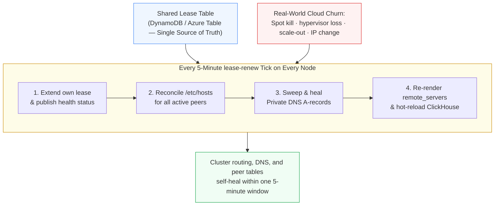
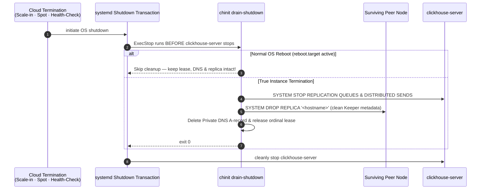

---
# Copyright (C) 2026 StackGen, Inc. All rights reserved.
# SPDX-License-Identifier: Apache-2.0
title: "Maintenance jobs"
nav_title: "Maintenance jobs"
nav_order: 8
permalink: /maintenance/
mermaid: true
description: >-
  The systemd timers that keep a chinit cluster healthy: lease renewal,
  schema and replica sync, queue healing, disk autoscaling, backups, and
  spot-instance draining.
---

# Maintenance Jobs & Self-Healing

<p class="lead">Getting ClickHouse running on a VM is only half the battle. Here is how <code>chinit</code> keeps a live, auto-scaling cluster healthy across Spot preemptions, stuck replication queues, filling disks, and rolling upgrades.</p>

In a Kubernetes cluster, a central controller loop runs 24/7 watching pod state and reconciling drift. On raw cloud VMs, there is no central controller — and if you try to replace it with a collection of cron scripts, those scripts quickly lose track of which identity the node holds, step on active merges, or fail silently.

`chinit` solves day-2 operations by embedding **every maintenance loop, healing routine, and shutdown hook as a subcommand of the same binary**, wired into `systemd` timers during `chinit boot`. Every subcommand loads the node's settled identity directly from `/var/lib/chinit/state.json` — never guessing or re-deriving who it is.

---

## 1. Continuous 5-Minute Convergence (`lease-renew`)

In an auto-scaled cloud fleet, **termination hooks are best-effort, never guaranteed**. If an underlying hypervisor crashes or an instance fails an EC2/VMSS hardware check, it vanishes without running a single shutdown command — leaving behind a stale Private DNS `A` record, outdated `/etc/hosts` entries on peers, and a dead host in ClickHouse's `remote_servers` configuration that slows down distributed queries.

Instead of assuming clean teardowns always happen, `chinit` runs a **level-triggered convergence loop** every 5 minutes via `chinit lease-renew`:



Even in the worst-case failure — pulling the plug on a VM — its lease TTL expires and every surviving node automatically purges its stale IP from `/etc/hosts`, Private DNS, and `remote_servers`.

---

## 2. Unified Graceful Draining (Spot + Scale-In + Health Checks)

Draining a stateful ClickHouse replica on an Auto Scaling Group VM is surprisingly tricky:
- Relying on external cloud lifecycle hooks (like EventBridge + SSM Run Command) introduces network hops and IAM failure modes right when the clock is ticking.
- EC2 and VMSS **health-check replacements** often skip scale-in lifecycle hooks altogether, going straight to OS `SIGTERM` / ACPI shutdown.
- If your shutdown script calls `systemctl stop clickhouse-server` *while* `systemd` is already executing a shutdown transaction, `systemd` can deadlock waiting on conflicting job dependencies — or stop ClickHouse *before* your drain script can issue `SYSTEM STOP REPLICATION QUEUES`!

`chinit` eliminates all three traps with two complementary mechanisms that invoke the exact same drain logic:

1. **Early Spot Preemption (`chinit spot-watch`)**: On Spot writer + reader nodes, a lightweight daemon polls the cloud metadata preemption endpoint every 2 seconds (AWS IMDS `spot/instance-action` or Azure Scheduled Events `Preempt`), starting the drain the instant the 2-minute cloud warning arrives.
2. **Universal OS Shutdown Hook (`chinit-shutdown-drain.service`)**: Installed inside `systemd`'s shutdown transaction with `After=clickhouse-server.service`. Because `systemd` stops units in **reverse** `After=` order, `ExecStop=/usr/local/bin/chinit drain-shutdown` is guaranteed to run *while `clickhouse-server` is still alive and accepting SQL commands*, across scale-ins, Spot kills, and health-check terminations alike.



<div class="callout callout-ok">
  <div class="callout-title">Reboot-Aware by Design</div>
  What if you run <code>sudo reboot</code> to apply a kernel patch? <code>drain-shutdown</code> inspects <code>systemctl list-jobs</code> for <code>reboot.target</code>. When a normal reboot is in progress, it intentionally skips dropping replicas and releasing the lease so the node comes right back up with its identity and data intact.
</div>

---

## 3. Replication Queue Healing & Online Disk Autoscaling

### Automatic Queue Recovery (`queue-heal`)
Under heavy instance churn, a ClickHouse `ReplicatedMergeTree` queue can stall when an entry references a data part that belonged to a peer terminated mid-fetch (`NO_REPLICA_HAS_PART`), or flip into read-only mode after a transient ClickHouse Keeper session blip.

Every hour, `chinit queue-heal` inspects `system.replicas` and `system.replication_queue`:
- **Active merges are respected**: If background merges are actively running, `queue-heal` backs off so it never interrupts healthy compaction work.
- **Read-only recovery**: Runs `SYSTEM RESTORE REPLICA` on tables left read-only after temporary Keeper disconnects.
- **Stuck queue recovery**: Runs `SYSTEM SYNC REPLICA` and, when merges are idle, `SYSTEM RESTART REPLICA` to clear wedged part-fetch entries.

### Zero-Downtime Volume Growth (`disk-autoscale`)
Running out of metadata disk space halts ClickHouse merges and inserts immediately. Every 5 minutes, `chinit disk-autoscale` checks filesystem utilization; when free space drops below threshold, it calls the AWS EBS `ModifyVolume` or Azure Managed Disk resize API and grows the mounted Linux filesystem online (`resize2fs` / `xfs_growfs`) without restarting ClickHouse.

---

## 4. Serverless Fleet Rollouts & Disruption Budgets

How do you coordinate rolling configuration updates or AMI replacements across a 15-node ClickHouse VM cluster when there is no Kubernetes controller?

`chinit` turns the shared lease table into a **distributed, epoch-fenced task queue** driven by two built-in subcommands:

- **The Coordinator (`fleet-converge`, every 5 min)**: Runs on `writer-0` — or, if `writer-0` is currently absent during a replacement, automatically fails over via **vacancy election** to the lowest-ordinal live writer. It sweeps task rows, detects executors whose heartbeats expired, increments the task's `epoch`, and safely re-dispatches stalled work within its retry budget.
- **The Executor (`task-poll`, every 2 min)**: Runs on every node, polling for tasks addressed to its hostname. Before executing a `refresh` or `rollout` motion, it checks the cluster **Disruption Budget** (`min_healthy_writers`, `min_healthy_readers`) against live peer status rows, heartbeats while working, and commits results using compare-and-swap on `epoch` so split-brain duplicate executions are impossible.

### Keeper Raft Quorum Protection
Rolling ClickHouse Keeper nodes carelessly can destroy cluster consensus. When you run `chinit fleet-rollout -role keeper`, `chinit` probes every Keeper node via the 4-letter `mntr` command before each step — refusing to roll a node unless a Raft leader is elected, at least 3 voting members exist, and a strict quorum is healthy, always rolling `keeper-0` last.

---

## Complete Maintenance Schedule

| Cadence | Subcommand | Active Roles | What It Protects Against |
|---|---|---|---|
| **Every 2 s** | `spot-watch` | `writer`, `reader` | Catches 2-minute cloud Spot preemption warnings immediately and starts graceful draining. |
| **Every 1 min** | `keeper-health` | `keeper` | Probes Keeper via `mntr` and emits `chinit_keeper_up` health metrics. |
| **Every 2 min** | `task-poll` | `writer`, `reader`, `keeper` | Claims and runs rolling refresh/rollout tasks behind the cluster disruption budget. |
| **Every 5 min** | `lease-renew` | `writer`, `reader` | Extends ordinal lease TTL; heals `/etc/hosts`, Private DNS `A` records, and `remote_servers`; publishes node health status. |
| **Every 5 min** | `schema-sync` | `writer`, `reader`, `backup` | Pulls missed DDL from live peers so late-joining or rebooted nodes converge automatically. |
| **Every 5 min** | `replica-sync` | `writer`, `reader`, `backup` | Runs `SYSTEM SYNC REPLICA` across local replicated tables. |
| **Every 5 min** | `disk-autoscale` | `writer`, `reader`, `keeper`, `backup` | Expands cloud volumes and filesystems online before disks fill up. |
| **Every 5 min** | `fleet-converge` | Coordinator `writer` | Sweeps fleet tasks, re-dispatches timed-out executors with bumped `epoch`, fails exhausted tasks. |
| **Every 10 min** | `spec-sync` | All roles | Watches object storage for `chinit.yaml` / bundle updates and triggers an in-place `--refresh` on drift. |
| **Every 15 min** | `schema-bootstrap` | `writer`, `reader` | Re-applies `bootstrap-ddl.sql` idempotently in case peers were unreachable at initial boot. |
| **Hourly** | `queue-heal` | `writer`, `reader` | Unsticks wedged replication queues and restores read-only replicas when merges are idle. |
| **Hourly** | `dead-replica-gc` | Coordinator `writer` | Drops lingering Keeper replica registrations for ordinals with no active lease. |
| **Daily** | `orphaned-gc` | Coordinator `writer` | Cleans up dropped bundle tables and unattached, untagged cloud volumes past retention age. |
| **Daily** | `backup-daily` | `backup` | Runs `clickhouse-backup` full and incremental snapshots to S3 or Azure Blob Storage. |
| **Daemon** | `exporter` | All roles | Serves fleet & ClickHouse Prometheus metrics on `:9150` (`/metrics` and `/clickhouse-metrics`). |
| **OS Shutdown** | `drain-shutdown` | `writer`, `reader` | Stops queues, drops peer replica metadata, deletes DNS, and releases lease on termination. |

---

## Hands-On Inspection & Node Cordoning

Every maintenance subcommand is just a CLI call away when you are debugging or operating a live node:

```bash
# Inspect all installed chinit timers and their next/last run times
systemctl list-timers --all 'chinit-*'

# Follow lease convergence logs
journalctl -u chinit-lease-renew.service --since "30 minutes ago"

# View cluster-wide node health, versions, spec hashes, and cordon state
chinit fleet-status

# Cordon a node before manual maintenance (excludes it from healthy budget counts & voluntary tasks)
sudo chinit cordon reader-2
# ... perform maintenance ...
sudo chinit uncordon reader-2
```

For full flag details on every subcommand, see the [CLI Reference]({{ '/cli/' | relative_url }}), or read the [Operator's Guide]({{ '/guide/' | relative_url }}) for step-by-step operational workflows.
