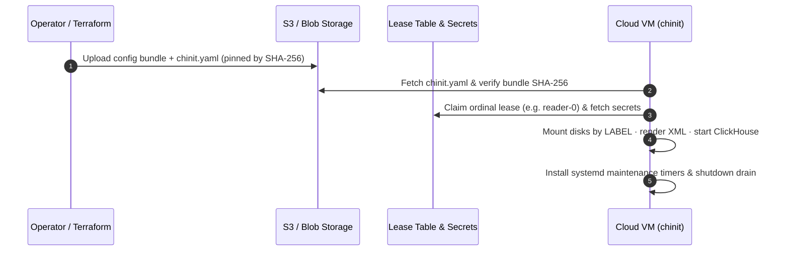

---
# Copyright (C) 2026 StackGen, Inc. All rights reserved.
# SPDX-License-Identifier: Apache-2.0
title: "Quickstart"
nav_title: "Quickstart"
nav_order: 2
permalink: /quickstart/
mermaid: true
description: >-
  Go from a fresh cloud VM to a bootstrapped, self-healing ClickHouse
  cluster member in five steps — install, spec, bundle, boot, automate.
---

# Quickstart

<p class="lead">Go from a fresh cloud VM to a bootstrapped, self-healing ClickHouse cluster member in five steps — and understand what happens under the hood at each stage.</p>

Before jumping into commands, here is the mental model of how a `chinit` cluster fits together:

1. **Cloud Storage (S3 or Azure Blob)** holds an immutable, SHA-256 verified **Configuration Bundle** (your cluster topology, static XMLs, and initial SQL schema) plus a small `chinit.yaml` spec per role.
2. **A Cloud Table (DynamoDB or Azure Table Storage)** acts as the cluster's lightweight coordination ledger — tracking which VM currently owns `writer-0` or `reader-2` without needing etcd or Kubernetes.
3. **Each VM** boots with `/usr/local/bin/chinit`, reads its `chinit.yaml`, claims its identity, renders its ClickHouse configs locally, starts the database, and wires up `systemd` timers to keep itself healthy.



> **Want a full multi-node cluster out of the box?** The repository's [Terraform modules](https://github.com/stackgenhq/chinit/tree/main/terraform) automate every cloud resource in this guide — buckets, lease tables, Private DNS zones, KMS/Key Vault secrets, IAM/RBAC roles, and Auto Scaling Groups — for both [AWS](https://github.com/stackgenhq/chinit/tree/main/terraform/aws) and [Azure](https://github.com/stackgenhq/chinit/tree/main/terraform/azure).

---

## Step 1: Install the Binary (or Launch the Golden AMI)

If you are on AWS in `us-west-2`, you can skip straight to Step 2 by launching our public golden AMI (`ami-0eaa398497899f070`), which already has ClickHouse `26.8.36.3` and `chinit` baked in.

On your own Ubuntu/Debian/RHEL VM, download the static binary and verify its cryptographic checksum:

```bash
CHINIT_VERSION=v0.1.0
ARCH=linux-arm64   # or linux-amd64

curl -fsSL -o chinit \
  "https://github.com/stackgenhq/chinit/releases/download/${CHINIT_VERSION}/chinit-${ARCH}"
curl -fsSL "https://github.com/stackgenhq/chinit/releases/download/${CHINIT_VERSION}/chinit-SHA256SUMS" \
  | grep "${ARCH}" | sed "s|chinit-${ARCH}|chinit|" | sha256sum -c -

sudo install -m 0755 chinit /usr/local/bin/chinit
chinit version
```

<div class="callout">
  <div class="callout-title">Why Checksum Verification Matters Here</div>
  <code>chinit</code> runs as root during instance initialization, formats block devices, and fetches database credentials. Verifying <code>chinit-SHA256SUMS</code> ensures a corrupted download or MITM proxy can never execute arbitrary code at boot.
</div>

---

## Step 2: Author a Declarative Node Spec (`chinit.yaml`)

Every node role (`writer`, `reader`, `keeper`, `backup`) runs the exact same `chinit` binary; only its `chinit.yaml` differs. Notice what is *not* in this file: there are **no raw passwords** (only secret store names) and **no Linux device paths like `/dev/nvme1n1`** (only filesystem labels, because cloud hypervisors reorder NVMe device names across reboots):

```yaml
role: reader
identity_mode: lease
cluster_name: demo
dns_zone_name: clickhouse.internal

config_bundle:
  bucket: my-config-bucket
  prefix: /clickhouse/demo/bootstrap
  sha256: 9f86d081884c7d659a2feaa0c55ad015a3bf4f1b2b0b822cd15d6c15b0f00a08

s3_data_bucket: my-data-bucket
claimer_table_name: demo-node-claims
reader_hostname_prefix: "reader-"
reader_count: 2
reader_max: 6

disks:
  metadata_label: CH_METADATA

secrets:
  admin_password: demo-admin-password

network:
  admin_allowed_networks: ["10.0.0.0/16"]
```

See the [Spec Reference]({{ '/spec/' | relative_url }}) for every available field, including disruption budgets and lifecycle hooks.

---

## Step 3: Upload the Configuration Bundle

At boot, `chinit` fetches the **Configuration Bundle** from the S3 bucket or Azure Blob container referenced in `config_bundle`. A bundle directory contains:

| File | Purpose |
|---|---|
| `chi.yaml` | Cluster topology, shards, profiles, and macros (compatible with Altinity operator CRs) |
| `keeper.yaml` | ClickHouse Keeper ensemble configuration and Raft settings |
| `network.xml`, `ssl.xml`, `storage.xml` | Static ClickHouse server XML fragments (ports, TLS, S3 tiered storage policies) |
| `bootstrap-ddl.sql` *(optional)* | Idempotent `CREATE DATABASE / TABLE IF NOT EXISTS` statements applied once ClickHouse starts |

`config_bundle.sha256` pins the exact digest of these files. If someone edits a file in S3 without updating the spec's digest — or if a partial upload is in progress while an instance scales out — `chinit` detects the hash mismatch and aborts with a fatal error rather than booting a misconfigured node into your cluster.

---

## Step 4: Preview and Boot the Node

Before mutating the machine, you can inspect the exact execution plan with `-dry-run`:

```bash
chinit boot -spec /var/lib/clickhouse-bootstrap/chinit.yaml -dry-run
```

Now run the convergent bootstrap pipeline:

```bash
sudo chinit boot -spec /var/lib/clickhouse-bootstrap/chinit.yaml
```

In a single run, `chinit boot`:
1. **Detects the cloud platform** automatically via DMI hardware signatures and IMDS (or `-cloud aws|azure`).
2. **Runs Phase 1 in parallel**: downloads and SHA-256 verifies the bundle, tunes kernel THP/file limits, mounts the `CH_METADATA` volume, claims the lowest free ordinal lease (e.g., `reader-0`), registers `reader-0.clickhouse.internal` in Private DNS, and writes secrets to `0600` files.
3. **Runs Phase 2 sequentially**: renders node-specific ClickHouse XML configs with the settled `reader-0` identity, registers the `systemd` shutdown-drain hook, starts `clickhouse-server`, applies `bootstrap-ddl.sql`, and enables recurring maintenance timers.

### Verify Your Running Node

```bash
# 1. Inspect settled node identity and step completion records
sudo cat /var/lib/chinit/state.json

# 2. Confirm ClickHouse is serving traffic
clickhouse-client --query "SELECT hostName(), version(), uptime()"

# 3. Check active day-2 maintenance timers
systemctl list-timers 'chinit-*'

# 4. View fleet-wide node health and lease inventory
sudo chinit fleet-status
```

If `chinit boot` is interrupted mid-flight (for example, while waiting for a newly attached EBS volume or IAM propagation), re-running the command reads `/var/lib/chinit/state.json`, skips every step already marked `done`, and finishes cleanly without re-claiming a second identity.

---

## Step 5: Automate Production Fleet Launches

In production, humans never SSH into instances to run `chinit boot`. Instead, your Auto Scaling Group or VMSS launches a pre-baked [Golden Image]({{ '/installation/' | relative_url }}) with a tiny (~1.5 KB) `user-data` wrapper script that:

1. Downloads `/var/lib/clickhouse-bootstrap/chinit.yaml` from your bundle bucket, and
2. Starts `chinit-boot.service` under `systemd` (`Restart=on-failure`).

From there, scaling out from 2 readers to 6 is as simple as sliding your Auto Scaling Group's desired capacity — every new VM claims its ordinal, syncs schema and replicas from peers, and joins query rotation in ~2–3 minutes with zero internet egress.

### Where to Go Next

- **[Installation & Golden Images]({{ '/installation/' | relative_url }})** — Pre-bake ClickHouse + `chinit` with Packer and configure least-privilege IAM/RBAC.
- **[The Boot Process]({{ '/boot/' | relative_url }})** — Understand why Phase 1/Phase 2 ordering prevents distributed split-brains.
- **[Maintenance Jobs]({{ '/maintenance/' | relative_url }})** — Explore how `chinit` heals stuck replicas, renews leases, and drains Spot instances.
