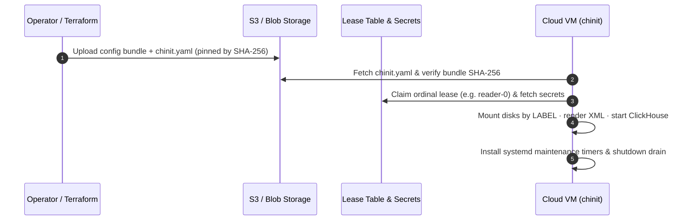

---
# Copyright (C) 2026 StackGen, Inc. All rights reserved.
# SPDX-License-Identifier: Apache-2.0
title: "Quickstart"
nav_title: "Quickstart"
nav_order: 2
permalink: /quickstart/
mermaid: true
description: >-
  Go from a fresh cloud VM to a bootstrapped, self-healing ClickHouse
  cluster member in five steps — install, spec, bundle, boot, automate.
---

# Quickstart

<p class="lead">Go from a fresh cloud VM to a bootstrapped, self-healing ClickHouse cluster member in five steps — and understand what happens under the hood at each stage.</p>

Before jumping into commands, here is the mental model of how a `chinit` cluster fits together:

1. **Cloud Storage (S3 or Azure Blob)** holds an immutable, SHA-256 verified **Configuration Bundle** (your cluster topology, static XMLs, and initial SQL schema) plus a small `chinit.yaml` spec per role.
2. **A Cloud Table (DynamoDB or Azure Table Storage)** acts as the cluster's lightweight coordination ledger — tracking which VM currently owns `writer-0` or `reader-2` without needing etcd or Kubernetes.
3. **Each VM** boots with `/usr/local/bin/chinit`, reads its `chinit.yaml`, claims its identity, renders its ClickHouse configs locally, starts the database, and wires up `systemd` timers to keep itself healthy.



> **Want a full multi-node cluster out of the box?** Jump straight to [Try It Locally with Docker Compose](#try-it-locally-with-docker-compose-copy--paste) below to run a 3-node cluster on your laptop with a single copy-pasted `compose.yaml`, or use the repository's [Terraform modules](https://github.com/stackgenhq/chinit/tree/main/terraform) to provision every cloud resource automatically on [AWS](https://github.com/stackgenhq/chinit/tree/main/terraform/aws) and [Azure](https://github.com/stackgenhq/chinit/tree/main/terraform/azure).

---

## Try It Locally with Docker Compose (Copy & Paste)

You can evaluate `chinit`'s full `systemd` boot pipeline, ordinal lease claiming (`writer-0`, `reader-0`), ClickHouse Keeper ensemble (`keeper-0`), OpenTelemetry log/metric/span shipping, and `ReplicatedMergeTree` replication locally using Docker Compose — **with zero cloud accounts and without cloning the repository**.

GitHub Actions builds and publishes a multi-arch (`linux/amd64`, `linux/arm64`) node image to `ghcr.io/stackgenhq/chinit-node:latest` containing ClickHouse, `systemd`, `otelcol`, `/usr/local/bin/chinit`, and a pre-baked local configuration bundle, secrets, and per-role specs.

### 1. Save this `compose.yaml` in any empty directory

```yaml
x-chinit-node: &chinit-node
  image: ghcr.io/stackgenhq/chinit-node:latest
  privileged: true
  cgroup: host
  stop_signal: SIGRTMIN+3
  stop_grace_period: 30s
  tmpfs:
    - /run
    - /run/lock
  ulimits:
    nofile:
      soft: 262144
      hard: 262144

services:
  otel-collector:
    image: otel/opentelemetry-collector-contrib:0.118.0
    command:
      - |
        --config=yaml:
        receivers:
          otlp:
            protocols:
              http:
                endpoint: 0.0.0.0:4318
        processors:
          batch: {}
        exporters:
          debug:
            verbosity: detailed
        service:
          pipelines:
            logs:
              receivers: [otlp]
              processors: [batch]
              exporters: [debug]
            metrics:
              receivers: [otlp]
              processors: [batch]
              exporters: [debug]
            traces:
              receivers: [otlp]
              processors: [batch]
              exporters: [debug]
    ports:
      - "4318:4318"
    networks:
      chnet:
        ipv4_address: 10.142.0.5

  keeper-0:
    <<: *chinit-node
    hostname: keeper-0
    environment:
      CHINIT_CLOUD: compose
      CHINIT_ROLE: keeper
      CHINIT_REGION: local
      CHINIT_PRIVATE_IP: 10.142.0.20
      CHINIT_INSTANCE_ID: compose-keeper-0
    volumes:
      - /sys/fs/cgroup:/sys/fs/cgroup:rw
      - ch-leases:/var/lib/chinit-cluster
      - keeper-0-data:/var/lib/clickhouse-keeper
      - keeper-0-ch:/var/lib/clickhouse
    networks:
      chnet:
        ipv4_address: 10.142.0.20
        aliases:
          - keeper-0
          - keeper-0.ch.local
    healthcheck:
      test: ["CMD-SHELL", "test -f /var/lib/cloud/instance/boot-finished && systemctl is-active --quiet clickhouse-keeper"]
      interval: 5s
      timeout: 5s
      retries: 24
      start_period: 15s

  writer-0:
    <<: *chinit-node
    hostname: writer-node-0
    depends_on:
      otel-collector:
        condition: service_started
      keeper-0:
        condition: service_healthy
    environment:
      CHINIT_CLOUD: compose
      CHINIT_ROLE: writer
      CHINIT_REGION: local
      CHINIT_PRIVATE_IP: 10.142.0.10
      CHINIT_INSTANCE_ID: compose-writer-0
    volumes:
      - /sys/fs/cgroup:/sys/fs/cgroup:rw
      - ch-leases:/var/lib/chinit-cluster
      - writer-0-data:/var/lib/clickhouse
    ports:
      - "8123:8123"
      - "9000:9000"
      - "9150:9150"
    networks:
      chnet:
        ipv4_address: 10.142.0.10
    healthcheck:
      test: ["CMD-SHELL", "test -f /var/lib/cloud/instance/boot-finished && curl -sf http://localhost:8123/ping"]
      interval: 5s
      timeout: 5s
      retries: 30
      start_period: 20s

  reader-0:
    <<: *chinit-node
    hostname: reader-node-0
    depends_on:
      otel-collector:
        condition: service_started
      keeper-0:
        condition: service_healthy
    environment:
      CHINIT_CLOUD: compose
      CHINIT_ROLE: reader
      CHINIT_REGION: local
      CHINIT_PRIVATE_IP: 10.142.0.30
      CHINIT_INSTANCE_ID: compose-reader-0
    volumes:
      - /sys/fs/cgroup:/sys/fs/cgroup:rw
      - ch-leases:/var/lib/chinit-cluster
      - reader-0-data:/var/lib/clickhouse
    ports:
      - "18123:8123"
      - "19150:9150"
    networks:
      chnet:
        ipv4_address: 10.142.0.30
    healthcheck:
      test: ["CMD-SHELL", "test -f /var/lib/cloud/instance/boot-finished && curl -sf http://localhost:8123/ping"]
      interval: 5s
      timeout: 5s
      retries: 30
      start_period: 20s

networks:
  chnet:
    driver: bridge
    ipam:
      config:
        - subnet: 10.142.0.0/24

volumes:
  ch-leases:
  keeper-0-data:
  keeper-0-ch:
  writer-0-data:
  reader-0-data:
```

### 2. Boot the cluster and test replication

```bash
# Start all services and wait for chinit-boot healthchecks to turn green
docker compose up -d --wait

# Inspect chinit-boot journal, active systemd maintenance timers, and fleet status
docker compose exec writer-0 journalctl -u chinit-boot.service --no-pager
docker compose exec writer-0 systemctl list-timers --all --no-pager
docker compose exec writer-0 chinit fleet-status

# Insert a row on writer-0 and verify ReplicatedMergeTree replication on reader-0
docker compose exec writer-0 clickhouse-client --user admin --password compose-admin-pass \
  --query "INSERT INTO default.events (source, message) VALUES ('compose', 'hello chinit')"

docker compose exec reader-0 clickhouse-client --user admin --password compose-admin-pass \
  --query "SELECT * FROM default.events"

# Query Prometheus metrics exposed by chinit-exporter (:9150 on writer-0, :19150 on reader-0)
curl -s http://localhost:9150/metrics | head -n 30

# Tear down the cluster and volumes when finished
docker compose down -v
```

> **Customizing local specs or building from source:** If you clone the repository, [`deploy/compose/docker-compose.yaml`](https://github.com/stackgenhq/chinit/blob/main/deploy/compose/docker-compose.yaml) bind-mounts `./specs`, `./bundle`, and `./secrets` so you can iterate on `chi.yaml` or `chinit.yaml` live and run `docker compose up --build -d`.

---

## Step 1: Install the Binary on a Cloud VM (or Launch the Golden AMI)

If you are on AWS in `us-west-2`, you can skip straight to Step 2 by launching our public golden AMI (`ami-0eaa398497899f070`), which already has ClickHouse `26.8.36.3` and `chinit` baked in.

On your own Ubuntu/Debian/RHEL VM, download the static binary and verify its cryptographic checksum:

```bash
CHINIT_VERSION=v0.1.0
ARCH=linux-arm64   # or linux-amd64

curl -fsSL -o chinit \
  "https://github.com/stackgenhq/chinit/releases/download/${CHINIT_VERSION}/chinit-${ARCH}"
curl -fsSL "https://github.com/stackgenhq/chinit/releases/download/${CHINIT_VERSION}/chinit-SHA256SUMS" \
  | grep "${ARCH}" | sed "s|chinit-${ARCH}|chinit|" | sha256sum -c -

sudo install -m 0755 chinit /usr/local/bin/chinit
chinit version
```

<div class="callout">
  <div class="callout-title">Why Checksum Verification Matters Here</div>
  <code>chinit</code> runs as root during instance initialization, formats block devices, and fetches database credentials. Verifying <code>chinit-SHA256SUMS</code> ensures a corrupted download or MITM proxy can never execute arbitrary code at boot.
</div>

---

## Step 2: Author a Declarative Node Spec (`chinit.yaml`)

Every node role (`writer`, `reader`, `keeper`, `backup`) runs the exact same `chinit` binary; only its `chinit.yaml` differs. Notice what is *not* in this file: there are **no raw passwords** (only secret store names) and **no Linux device paths like `/dev/nvme1n1`** (only filesystem labels, because cloud hypervisors reorder NVMe device names across reboots):

```yaml
role: reader
identity_mode: lease
cluster_name: demo
dns_zone_name: clickhouse.internal

config_bundle:
  bucket: my-config-bucket
  prefix: /clickhouse/demo/bootstrap
  sha256: 9f86d081884c7d659a2feaa0c55ad015a3bf4f1b2b0b822cd15d6c15b0f00a08

s3_data_bucket: my-data-bucket
claimer_table_name: demo-node-claims
reader_hostname_prefix: "reader-"
reader_count: 2
reader_max: 6

disks:
  metadata_label: CH_METADATA

secrets:
  admin_password: demo-admin-password

network:
  admin_allowed_networks: ["10.0.0.0/16"]
```

See the [Spec Reference]({{ '/spec/' | relative_url }}) for every available field, including disruption budgets and lifecycle hooks.

---

## Step 3: Upload the Configuration Bundle

At boot, `chinit` fetches the **Configuration Bundle** from the S3 bucket or Azure Blob container referenced in `config_bundle`. A bundle directory contains:

| File | Purpose |
|---|---|
| `chi.yaml` | Cluster topology, shards, profiles, and macros (compatible with Altinity operator CRs) |
| `keeper.yaml` | ClickHouse Keeper ensemble configuration and Raft settings |
| `network.xml`, `ssl.xml`, `storage.xml` | Static ClickHouse server XML fragments (ports, TLS, S3 tiered storage policies) |
| `bootstrap-ddl.sql` *(optional)* | Idempotent `CREATE DATABASE / TABLE IF NOT EXISTS` statements applied once ClickHouse starts |

`config_bundle.sha256` pins the exact digest of these files. If someone edits a file in S3 without updating the spec's digest — or if a partial upload is in progress while an instance scales out — `chinit` detects the hash mismatch and aborts with a fatal error rather than booting a misconfigured node into your cluster.

---

## Step 4: Preview and Boot the Node

Before mutating the machine, you can inspect the exact execution plan with `-dry-run`:

```bash
chinit boot -spec /var/lib/clickhouse-bootstrap/chinit.yaml -dry-run
```

Now run the convergent bootstrap pipeline:

```bash
sudo chinit boot -spec /var/lib/clickhouse-bootstrap/chinit.yaml
```

In a single run, `chinit boot`:
1. **Detects the cloud platform** automatically via DMI hardware signatures and IMDS (or `-cloud aws|azure`).
2. **Runs Phase 1 in parallel**: downloads and SHA-256 verifies the bundle, tunes kernel THP/file limits, mounts the `CH_METADATA` volume, claims the lowest free ordinal lease (e.g., `reader-0`), registers `reader-0.clickhouse.internal` in Private DNS, and writes secrets to `0600` files.
3. **Runs Phase 2 sequentially**: renders node-specific ClickHouse XML configs with the settled `reader-0` identity, registers the `systemd` shutdown-drain hook, starts `clickhouse-server`, applies `bootstrap-ddl.sql`, and enables recurring maintenance timers.

### Verify Your Running Node

```bash
# 1. Inspect settled node identity and step completion records
sudo cat /var/lib/chinit/state.json

# 2. Confirm ClickHouse is serving traffic
clickhouse-client --query "SELECT hostName(), version(), uptime()"

# 3. Check active day-2 maintenance timers
systemctl list-timers 'chinit-*'

# 4. View fleet-wide node health and lease inventory
sudo chinit fleet-status
```

If `chinit boot` is interrupted mid-flight (for example, while waiting for a newly attached EBS volume or IAM propagation), re-running the command reads `/var/lib/chinit/state.json`, skips every step already marked `done`, and finishes cleanly without re-claiming a second identity.

---

## Step 5: Automate Production Fleet Launches

In production, humans never SSH into instances to run `chinit boot`. Instead, your Auto Scaling Group or VMSS launches a pre-baked [Golden Image]({{ '/installation/' | relative_url }}) with a tiny (~1.5 KB) `user-data` wrapper script that:

1. Downloads `/var/lib/clickhouse-bootstrap/chinit.yaml` from your bundle bucket, and
2. Starts `chinit-boot.service` under `systemd` (`Restart=on-failure`).

From there, scaling out from 2 readers to 6 is as simple as sliding your Auto Scaling Group's desired capacity — every new VM claims its ordinal, syncs schema and replicas from peers, and joins query rotation in ~2–3 minutes with zero internet egress.

### Where to Go Next

- **[Installation & Golden Images]({{ '/installation/' | relative_url }})** — Pre-bake ClickHouse + `chinit` with Packer and configure least-privilege IAM/RBAC.
- **[The Boot Process]({{ '/boot/' | relative_url }})** — Understand why Phase 1/Phase 2 ordering prevents distributed split-brains.
- **[Maintenance Jobs]({{ '/maintenance/' | relative_url }})** — Explore how `chinit` heals stuck replicas, renews leases, and drains Spot instances.
