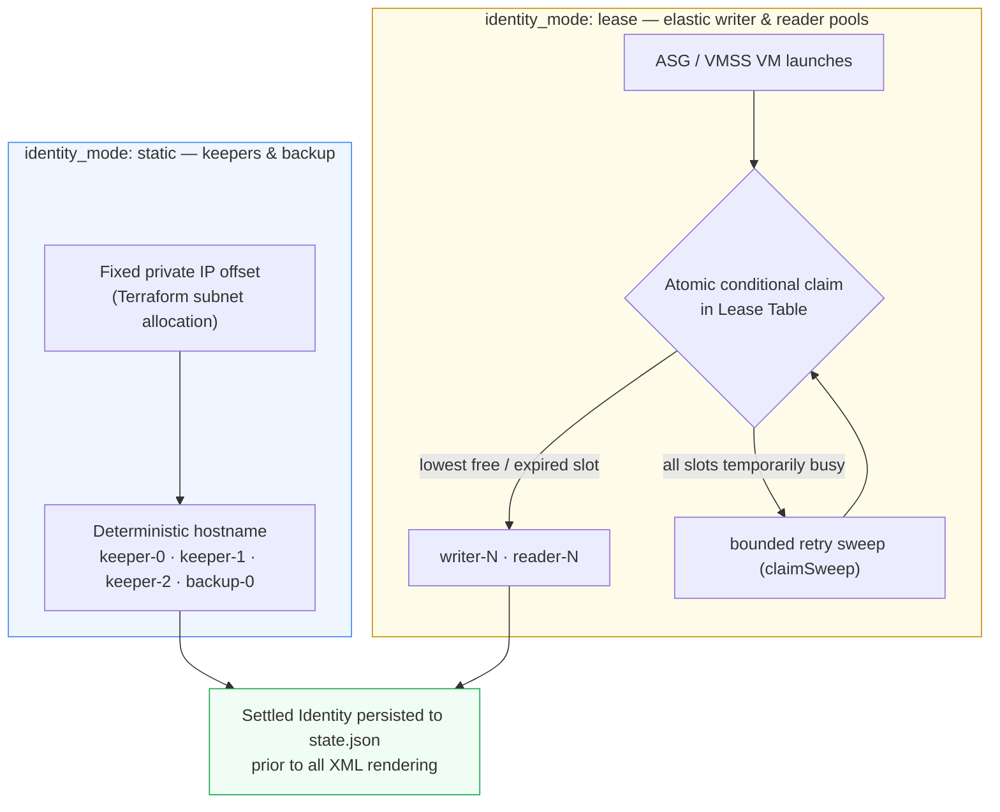

---
# Copyright (C) 2026 StackGen, Inc. All rights reserved.
# SPDX-License-Identifier: Apache-2.0
title: "The spec"
nav_title: "The spec"
nav_order: 7
permalink: /spec/
mermaid: true
description: >-
  Complete chinit.yaml reference: roles, identity modes, lease ceilings,
  disks, secrets, disruption budgets, telemetry, and lifecycle hooks.
---

# The Spec — `chinit.yaml`

<p class="lead">One typed, cloud-neutral YAML file per role defines everything <code>chinit</code> needs to bootstrap, secure, scale, and maintain a ClickHouse node.</p>

## Four Design Principles Behind `chinit.yaml`

<div class="grid-2">
  <div class="card">
    <h4>1. Spec Is Data; Binary Is Logic</h4>
    <p>There are no embedded bash templates inside <code>chinit.yaml</code>. Behavioral rules live in compiled, conformance-tested Go code; the spec only declares topology, labels, and policy thresholds.</p>
  </div>
  <div class="card">
    <h4>2. Secrets by Reference, Never by Value</h4>
    <p><code>chinit.yaml</code> only stores secret <em>names</em> (e.g., <code>demo-admin-password</code>). Raw credentials are resolved at boot via IAM / Managed Identity into <code>0600</code> files and never touch logs or <code>state.json</code>.</p>
  </div>
  <div class="card">
    <h4>3. Labels Over Device Paths</h4>
    <p>Modern AWS Nitro and Azure NVMe hypervisors attach block devices in non-deterministic order (<code>/dev/nvme1n1</code> vs <code>/dev/nvme2n1</code>). <code>chinit.yaml</code> mounts volumes strictly by filesystem <code>LABEL</code>.</p>
  </div>
  <div class="card">
    <h4>4. Cryptographically Pinned Bundles</h4>
    <p><code>config_bundle.sha256</code> locks the exact digest of your XMLs, <code>chi.yaml</code>, and SQL DDL. Half-uploaded or unreviewed bucket edits fail closed before touching ClickHouse.</p>
  </div>
</div>

---

## Roles & Identity Modes

```yaml
role: reader              # writer | reader | keeper | backup
identity_mode: lease      # static | lease
```

- **`lease` mode (`writer` and `reader` Auto Scaling Groups / VMSS)**: Each launching VM atomically claims a free or expired ordinal (`0 .. max-1`) in DynamoDB or Azure Table Storage *before* rendering any configuration. When Spot or scale-in replaces a VM, its successor claims the freed ordinal and inherits its replica slot.
- **`static` mode (`keeper` and `backup` fixed instances)**: The VM's private IP is allocated at a deterministic subnet offset by Terraform, and `chinit` derives the hostname directly from the final IP octet (`10.0.1.20` → `keeper-0`, `10.0.1.30` → `backup-0`).



### Understanding Ordinal Ceilings (`reader_max` vs. `reader_count`)

<div class="callout callout-warn">
  <div class="callout-title">Set <code>*_max</code> to Your Auto Scaling Group's Maximum Size!</div>
  In <code>lease</code> mode, <code>reader_max</code> and <code>writer_max</code> define the upper bound of ordinals a scaling fleet is allowed to claim (and reserve CR slots for in ClickHouse configuration). Always set <code>reader_max</code> equal to your ASG/VMSS <code>max_size</code> — not its initial desired capacity — so scale-out bursts never run out of claimable slots.
</div>

```yaml
reader_hostname_prefix: "reader-"
reader_count: 2            # initial baseline count
reader_max: 8              # claim ceiling (= ASG max_size; claims reader-0 .. reader-7)
writer_hostname_prefix: "writer-"
writer_max: 2              # claims writer-0 .. writer-1
claimer_table_name: prod-ch-claims
```

---

## Cluster Topology & Network Allowlists

```yaml
cluster_name: analytics
dns_zone_name: ch.internal
writer_nodes: []                                  # populated only when writers use static identity
keeper_nodes: ["keeper-0", "keeper-1", "keeper-2"]
timezone: UTC
multi_az: false                                   # opt-in multi-AZ placement validation

network:
  admin_allowed_networks: ["10.40.0.0/16"]
  writer_allowed_networks: ["10.40.0.0/16"]
  subnet_cidr: 10.40.1.0/24
  subnet_cidrs: ["10.40.1.0/24", "10.40.2.0/24"]  # multi-AZ peer subnets for inter-replica traffic
```

---

## Configuration Bundle, Disks, and Secrets

```yaml
config_bundle:
  bucket: prod-ch-config                          # S3 bucket or Azure Blob container name
  prefix: /clusters/analytics/bootstrap
  sha256: "9f86d081884c7d659a2feaa0c55ad015a3bf4f1b2b0b822cd15d6c15b0f00a08"

disks:
  metadata_label: CH_METADATA                     # required data/metadata filesystem LABEL
  cache_label: CH_CACHE                           # optional NVMe/SSD cache disk; falls back to local dir
  keeper_label: CH_KEEPER                         # optional dedicated Raft log disk for keeper role

secrets:
  admin_password: analytics-ch-admin              # AWS Secrets Manager or Azure Key Vault secret names
  writer_password: analytics-ch-writer
  tls_certificate: analytics-ch-tls               # optional; self-signed generated if omitted
```

---

## Tiered Storage, Backups, and OpenTelemetry

```yaml
s3_data_bucket: prod-ch-tiered-data               # object storage bucket for zero-copy/S3-backed MergeTree

backup:
  bucket: prod-ch-backups                         # empty string disables backups
  retention_days: 14
  backup_replica_hostname: "backup-0"
  is_backup_replica: false                        # true on the dedicated backup role spec

log_shipping:
  endpoint: "https://otel.internal:4318"          # empty string cleanly disables OTLP push export
  agent: otel                                     # otel | fluentbit
  headers: "Authorization=Bearer ..."             # optional comma-separated OTLP HTTP headers
```

When `log_shipping.endpoint` is configured with `agent: otel`, it unifies node observability:
1. **Server & Bootstrap Logs**: Configures the local OpenTelemetry Collector to ship ClickHouse server logs alongside `chinit` structured `journald` records.
2. **Short-Lived Job Metrics**: Because `chinit` maintenance jobs run as oneshot `systemd` timers (which exit before a Prometheus scraper might poll them), `chinit` pushes OTLP metrics (`chinit_job_runs`, `chinit_job_duration_seconds`, `chinit_boot_step_duration_seconds`, `chinit_boot_outcomes`, `chinit_keeper_up`, and `chinit_disk_*`) directly on exit with low-cardinality labels (`cluster`, `role`, `job`, `outcome`, `step`, `host`).

---

## Disruption Budgets & Lifecycle Hooks

### Protecting Availability During Rollouts (`disruption`)
When `task-poll` executes voluntary operations (rolling config refreshes or AMI replacements), it checks the live health rows published by `lease-renew` and defers execution if proceeding would drop healthy capacity below your budget:

```yaml
disruption:
  min_healthy_writers: 1    # safety floor: defaults to 1 even if 0 is specified
  min_healthy_readers: 2    # keep at least 2 uncordoned, healthy readers serving queries
```

*(If status rows cannot be read from the cloud table, `chinit` fails closed and defers voluntary disruptions rather than guessing.)*

### Custom Lifecycle Hooks (`hooks`)
Need to register a node with an internal service mesh, warm a local cache after boot, or notify an external load balancer before draining? Lifecycle hooks run under `sh -c` with `CHINIT_ROLE`, `CHINIT_HOSTNAME`, `CHINIT_CLUSTER`, and `CHINIT_INSTANCE_ID` populated in the environment:

```yaml
hooks:
  items:
    - event: pre_boot               # runs before Phase 1 begins
      name: validate-subnet
      command: /usr/local/bin/check-env.sh
      critical: true                # failure aborts boot immediately
    - event: post_boot              # runs after boot_finished
      name: warm-query-cache
      command: /usr/local/bin/warm-cache.sh
      timeout_seconds: 60           # defaults to 30s when 0
    - event: pre_drain              # runs before replication queues stop
      name: lb-deregister
      command: /usr/local/bin/deregister-lb.sh
    - event: post_drain             # runs after lease & DNS release
      name: audit-notify
      command: /usr/local/bin/notify-terminated.sh
```

> **Why drain hooks never block teardown**: Even if `critical: true` is set on a `pre_drain` or `post_drain` hook, `chinit` logs any hook error and continues draining — ensuring a broken webhook can never strand a terminating VM's lease or replica registration.

---

## Quick Field Reference

| Field | Type | Summary |
|---|---|---|
| `role` | `string` | `writer`, `reader`, `keeper`, or `backup` |
| `identity_mode` | `string` | `lease` (ASG/VMSS ordinal claim) or `static` (IP-octet mapping) |
| `cluster_name`, `dns_zone_name` | `string` | Logical cluster name and Private DNS zone suffix |
| `writer_max`, `reader_max` | `int` | Maximum claimable ordinal ceiling for elastic pools |
| `claimer_table_name` | `string` | DynamoDB / Azure Table name hosting leases, status rows, and fleet tasks |
| `config_bundle.{bucket,prefix,sha256}` | `object` | Object storage coordinates and mandatory SHA-256 bundle digest |
| `disks.{metadata_label,cache_label,keeper_label}` | `object` | Filesystem `LABEL` names for volume discovery and mounting |
| `secrets.*` | `object` | Secret store names resolved into `0600` files during Phase 1 |
| `network.*` | `object` | Client allowlist CIDRs and intra-cluster subnet CIDRs |
| `s3_data_bucket` | `string` | Tiered storage bucket/container name (optional) |
| `backup.*` | `object` | `clickhouse-backup` target bucket, retention, and replica designation |
| `log_shipping.{endpoint,agent,headers}` | `object` | OTLP / Fluent Bit log and metric export configuration |
| `disruption.{min_healthy_writers,min_healthy_readers}` | `object` | Healthy capacity floor enforced during voluntary fleet rollouts |
| `hooks.items[]` | `list` | Custom `pre_boot`, `post_boot`, `pre_drain`, and `post_drain` commands |
| `multi_az` | `bool` | Opt-in multi-AZ subnet and placement validation |
| `cloud` | `string` | Optional explicit cloud override (`aws` or `azure`) |

The canonical Go struct definition and validation rules live in [`pkg/chinit/domain/model/spec.go`](https://github.com/stackgenhq/chinit/blob/main/pkg/chinit/domain/model/spec.go).
